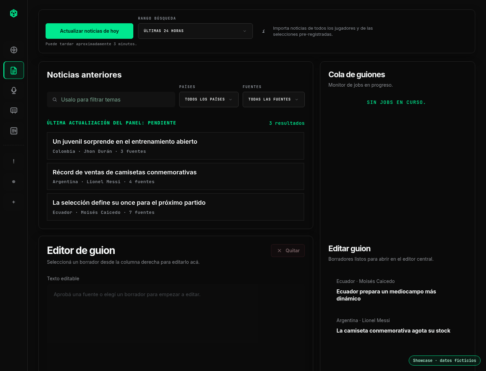
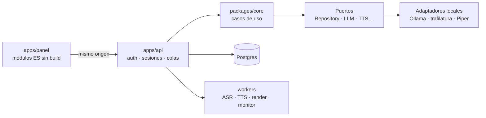

# Newsroom Video Automation

**Un pipeline de noticias local-first que lleva una historia desde el
descubrimiento hasta un video renderizado sin claves de API ni cuentas en la
nube.**

*Read this in [English](README.md).*


El GIF es un loop corto del panel en modo showcase (`/?showcase=1`, datos
ficticios): navegación del pipeline, la vista de aprobación/Guiones, Prensa,
Voz, Subtítulos, Proyectos y Ajustes. El [MP4](docs/images/demo.mp4) es el
recorrido completo de 34 segundos.

| Panel · Guiones | Panel · Prensa |
|---|---|
|  |  |

## Qué hace

El producto convierte una señal de noticias en un video corto publicable:

1. **Prensa** consulta feeds RSS públicos, extrae el texto de los artículos
   localmente y agrupa historias relacionadas en temas de aprobación.
2. **Guiones** permite aprobar un tema; el core redacta un guion, lo valida
   contra la fuente y guarda un borrador versionado.
3. **Voz** genera la narración con un motor TTS local y deja el audio junto al
   guion.
4. **Subtítulos** transcribe o recibe audio, alinea los subtítulos y los quema
   sobre el video.
5. **Proyectos** compone la marca, los overlays y los subtítulos en un MP4 final
   con Remotion.

Alrededor del pipeline hay un producto real: interfaz bilingüe ES/EN, login
multiusuario con roles, presencia, pantalla de administración, bandeja de
aprobaciones y una API HTTP autenticada que atiende todas las peticiones del
navegador.

## Arquitectura



El detalle de límites, puertos y flujo de peticiones está en
[docs/ARCHITECTURE.md](docs/ARCHITECTURE.md). Las decisiones principales se
registran como [ADRs](docs/adr/).

## Stack

| Capa | Elección | Motivo |
|---|---|---|
| UI | HTML, CSS y módulos ES sin framework | Sin paso de build, fácil de inspeccionar |
| API | Node.js en `apps/api` | Un solo backend para auth, sesiones y colas |
| Dominio | Casos de uso en `packages/core` | Las reglas de n8n pasan a código testeado |
| Datos | Postgres 16 + migraciones SQL versionadas | Mismo motor que Supabase, pero local |
| IA local | Ollama, faster-whisper, Qwen TTS / Piper | Corre en la misma máquina, con fallback CPU |
| Video | Remotion | Composiciones de marca programáticas |
| Empaquetado | Docker Compose + instaladores + CLI | Un camino de instalación para Linux y Windows |

## Local-first por defecto

La configuración por defecto necesita **cero claves de API y cero cuentas en la
nube**. Cada capacidad externa está detrás de un puerto con un adaptador local;
los servicios externos son opcionales y están apagados por defecto.

| Capacidad | Default local | Adaptador opcional |
|---|---|---|
| Guiones / clustering | **Ollama** | Cualquier endpoint compatible con OpenAI |
| Extracción de artículos | **trafilatura** | — |
| Búsqueda de imágenes | **SearXNG** + Wikimedia Commons | — |
| Base de datos | **Postgres** 16 | Cualquier Postgres vía `DATABASE_URL` |
| Blobs | Sistema de archivos local | S3-compatible |
| Voz a texto | **faster-whisper** (`asr-worker`) | — |
| Texto a voz | Qwen TTS + **Piper** en CPU | — |
| Descarga de medios | **yt-dlp** local | — |
| Notificaciones | Consola | **Mailpit** local / SMTP real |
| Orquestación | Cola y scheduler en proceso | Perfil **n8n** opcional |
| Exportación | python-docx `.docx` + Markdown | — |

Los workers de GPU comparten un slot entre procesos para que una tarjeta de
8 GB nunca cargue el LLM, Whisper y TTS a la vez.

## Inicio rápido (un comando)

Linux / macOS:

```bash
git clone https://github.com/<tu-cuenta>/newsroom-video-automation.git
cd newsroom-video-automation
./install.sh --yes
```

Windows 10/11:

```powershell
git clone https://github.com/<tu-cuenta>/newsroom-video-automation.git
cd newsroom-video-automation
.\install.ps1 -Yes
```

El instalador verifica Docker, disco, RAM y puertos, detecta una GPU NVIDIA,
genera un `.env` con secretos aleatorios, descarga los modelos locales, ejecuta
las migraciones, crea el primer administrador y levanta el stack. Volver a
ejecutarlo repara o actualiza la instalación.

Después se usa la CLI de control:

```bash
newsroom status
newsroom doctor
newsroom logs api
newsroom down
```

El panel queda en **http://127.0.0.1:8080**. El flujo manual con
`docker compose` y cómo abrirlo a la LAN están en [docs/INSTALL.md](docs/INSTALL.md).

Para una demo sin descargar un LLM, el repositorio incluye un perfil CPU
determinista usado por el test de navegador:

```bash
cp e2e/.env.example .env
docker compose up -d --build postgres searxng mailpit demo-worker api panel
docker compose run --rm seed
pnpm install --frozen-lockfile
pnpm exec playwright test
```

## Mapa del repositorio

```text
apps/api/             API HTTP, auth, sesiones, cola, composition root
apps/panel/           UI editorial en módulos ES
packages/core/        Casos de uso y puertos del dominio
packages/data/        Repositorios, blobs y adaptadores
packages/adapters/    Adaptadores locales para cada capacidad
services/             asr-worker, tts-worker, renderer, subtítulos, monitor
infra/                Migraciones, n8n opcional, instaladores
docs/                 Arquitectura, ADRs, instalación, modelo de datos
examples/             Marca ficticia y export de referencia de n8n
tools/                Generador de assets y tests estructurales
```

## Pruebas

```bash
node --test packages/core/test/*.test.js packages/data/test/*.test.js \
  packages/adapters/test/*.test.js apps/api/test/*.test.js
uv run --with pytest pytest apps/panel/tests -q
python3 -m unittest discover -s tools/tests -v
pnpm exec playwright test
```

La CI ejecuta las suites de JavaScript, Python y herramientas, valida los
perfiles de Compose y corre el camino feliz de Playwright contra el stack sin
claves. Algunos fallos preexistentes de panel/subtítulos/monitor se reportan como
informativos en lugar de ocultarse; el detalle está en el log del proyecto.

## Alcance honesto

- Este repositorio es una **reconstrucción de portafolio**, no un sistema en
  producción. Está pensado para instalarse y ejecutarse localmente; nada se
  despliega a internet.
- El despliegue privado original dependía de n8n, Supabase y varias claves de
  API. Esos caminos ahora son adaptadores locales; el export histórico de n8n
  queda solo como referencia en `examples/n8n/`.
- La demo CPU por defecto usa adaptadores deterministas para los pasos de
  workers, así un visitante recorre el flujo completo sin GPU ni descarga de
  modelos. Los caminos reales de Ollama / Whisper / Qwen / Piper están
  disponibles con el perfil `gpu` y el instalador.
- La interfaz principal, la navegación y las pantallas de administración están
  completamente en ES/EN; algunas etiquetas profundas y valores generados siguen
  en su idioma de origen.
- **Construido con asistencia de IA.** Un agente autónomo implementó esta
  reconstrucción a partir de un documento de especificación revisado, con tests,
  verificación local y revisión humana en los puntos de decisión.

## Licencia de Remotion

El renderer usa [Remotion](https://www.remotion.dev/). Remotion es gratuito para
individuos y equipos pequeños; revisa su licencia antes de un uso comercial.

## Documentación

- [Arquitectura](docs/ARCHITECTURE.md)
- [Decisiones de arquitectura](docs/adr/)
- [Guía de instalación](docs/INSTALL.md)
- [Modelo de datos](docs/data-model.md)
- [Manifiesto de assets](ASSETS.md)
- [README en inglés](README.md)

## Licencia

[MIT](LICENSE) © Eduardo Pacheco. Los medios de marca de este repositorio son
ficticios y se generan por código; consulta [ASSETS.md](ASSETS.md) para orígenes
y licencias de fuentes.
