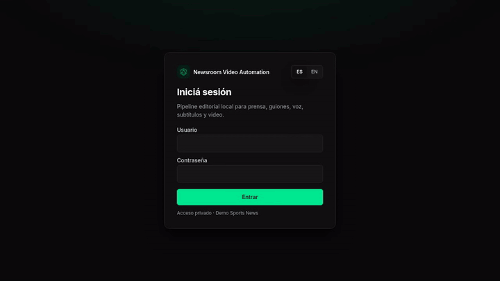
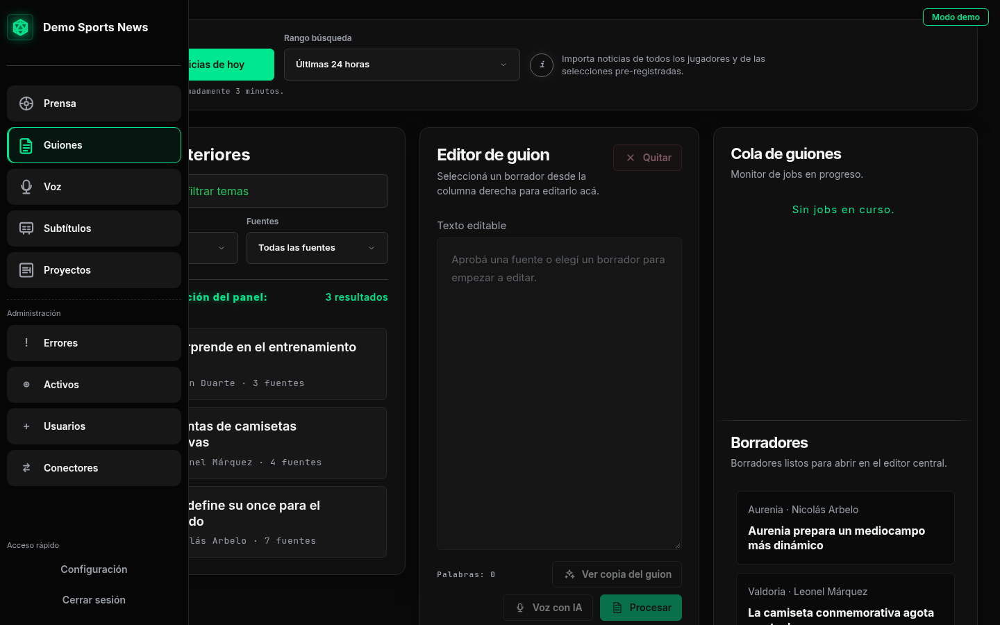
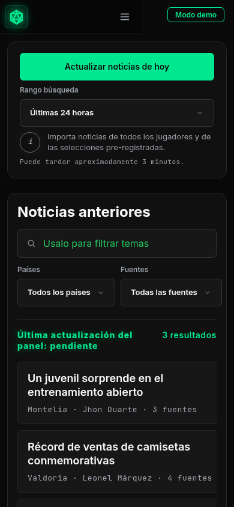
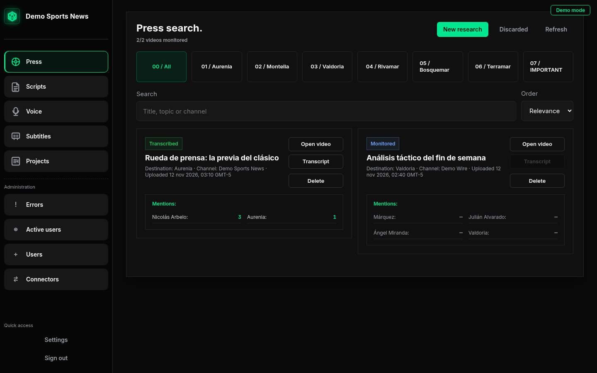
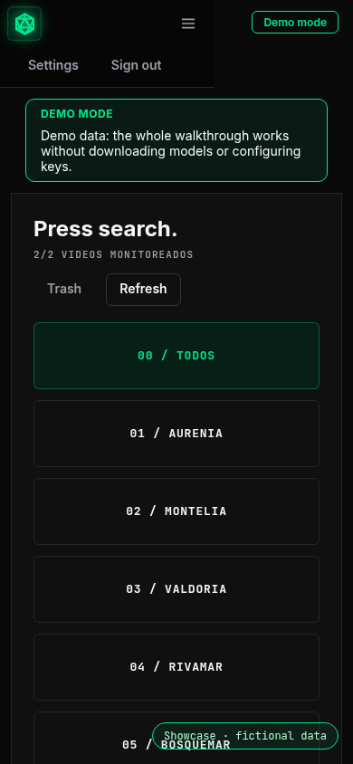
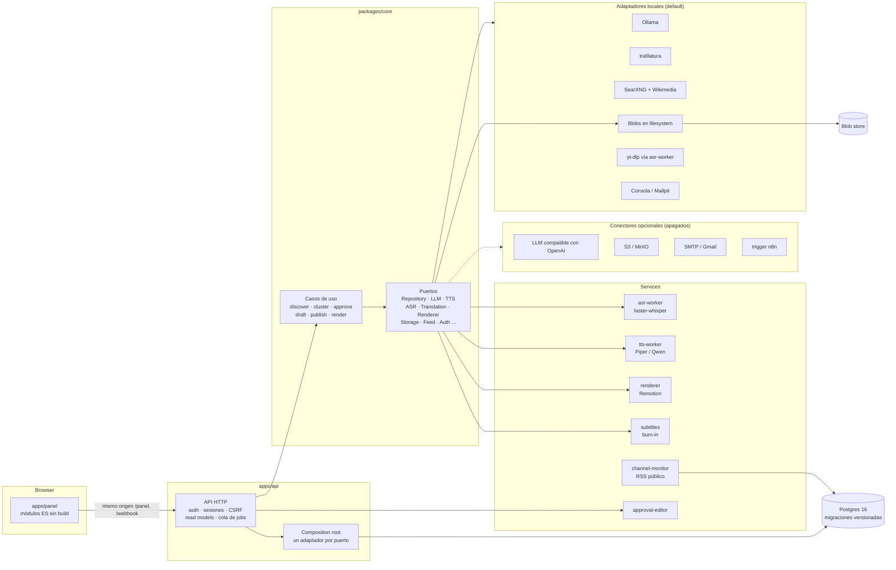

# Newsroom Video Automation

[](https://github.com/<tu-cuenta>/newsroom-video-automation/actions/workflows/ci.yml)
[](LICENSE)
[](#local-first-por-defecto)

**Un pipeline de noticias local-first que lleva una historia desde el
descubrimiento hasta un video renderizado sin claves de API ni cuentas en la
nube.**

*Read this in [English](README.md).*



El GIF es un loop corto de una ejecución real en modo demo; el
[MP4](docs/images/demo.mp4) es el recorrido completo de 34 segundos. Ambos se grabaron desde el
stack en ejecución con la historia ficticia sembrada, no desde un mockup.

| Guiones · ES · escritorio | Guiones · ES · móvil |
|---|---|
|  |  |

| Prensa · EN · escritorio | Prensa · EN · móvil |
|---|---|
|  |  |

Hay capturas de escritorio y móvil de cada vista, en español e inglés, en
[`docs/images/screens/`](docs/images/screens/); las genera la suite de QA visual.

## Qué hace

El producto convierte una señal de noticias en un video corto publicable:

1. **Prensa** consulta feeds RSS públicos, extrae el texto de los artículos
   localmente y agrupa historias relacionadas en temas de aprobación.
2. **Guiones** permite aprobar un tema; el core redacta un guion, lo valida
   contra la fuente y guarda un borrador versionado.
3. **Voz** genera la narración con un motor TTS local y deja el audio junto al
   guion.
4. **Subtítulos** transcribe o recibe audio, alinea los subtítulos y los quema
   sobre el video.
5. **Proyectos** compone la marca, los overlays y los subtítulos en un MP4 final
   con Remotion.

Alrededor del pipeline hay un producto real: interfaz bilingüe ES/EN, login
multiusuario con roles, sesiones, presencia, área de administración, pantallas
de aprobación y conectores, tema claro/oscuro y una API HTTP autenticada que
atiende todas las peticiones del navegador.

## Arquitectura



El detalle de límites, el mapa completo de puertos/adaptadores y los flujos de
peticiones están en [docs/ARCHITECTURE.md](docs/ARCHITECTURE.md). Las decisiones
principales se registran como [ADRs](docs/adr/).

## Dos modos reales

El instalador pregunta qué modo usar y `newsroom mode demo|local` permite
cambiarlo después. **Modo demo** es determinista e instantáneo; **Modo local**
ejecuta los modelos y medios locales reales. El camino demo corre en cada push;
el camino local tiene un job de CI nocturno/manual que valida los medios reales.

| Modo | Qué corre | Modelos | Ideal para |
|---|---|---|---|
| `demo` (default) | Adaptadores deterministas, historia ficticia sembrada, sin descargas | Ninguno | Primera mirada, capturas y el happy path del navegador |
| `local` | Guiones con Ollama (`qwen2.5:3b-instruct`), extracción con trafilatura, voz Piper en español, subtítulos faster-whisper `small` int8 y un MP4 Remotion 720p real en CPU | Ollama, Whisper y Piper | Una ejecución offline real |
| `local --gpu` | El mismo pipeline con los workers GPU y Qwen TTS | Los mismos más modelos GPU | Una máquina NVIDIA, renders más rápidos |

El panel siempre muestra el badge **Modo demo / Demo mode** cuando el set de
adaptadores demo está activo, para que una captura no se confunda con una
ejecución real de IA. Los workers GPU comparten un slot entre procesos para que
una tarjeta de 8 GB nunca cargue el LLM, Whisper y TTS a la vez.

## Local-first por defecto

La configuración por defecto necesita **cero claves de API y cero cuentas en la
nube**. Cada capacidad externa está detrás de un puerto con un adaptador local;
los servicios externos son opcionales y están apagados por defecto.

| Capacidad | Default local | Adaptador opcional |
|---|---|---|
| Guiones / clustering | **Ollama** (`qwen2.5:3b-instruct`, cualquier modelo local) | Cualquier endpoint compatible con OpenAI |
| Extracción de artículos | **trafilatura** (fetch + extracción de texto principal) | — |
| Búsqueda de imágenes | **SearXNG** + Wikimedia Commons (sin clave) | — |
| Base de datos | **Postgres** 16 con migraciones versionadas | Cualquier Postgres vía `DATABASE_URL` |
| Blobs | Filesystem local servido por la API | Almacenamiento S3-compatible (probado con MinIO) |
| Voz a texto | **faster-whisper** en `asr-worker` (CPU int8, GPU opcional) | — |
| Texto a voz | **Piper** en CPU; Qwen en GPU | — |
| Descarga de medios | **yt-dlp** en el ASR worker | — |
| Notificaciones | Adaptador de consola | **Mailpit** local; SMTP/Gmail para un buzón real |
| Orquestación | Cola y scheduler en proceso | Perfil **n8n** opcional con dos workflows slim |
| Exportación | python-docx `.docx` + Markdown | — |

## Conectores

Cada integración es un adaptador detrás de un puerto, seleccionable desde
`.env`, visible en **Administración → Conectores** con su estado en vivo y
documentado en [`docs/CONNECTORS.md`](docs/CONNECTORS.md).

| Conector | Variable | Default | Qué hace |
|---|---|---|---|
| Ollama / cualquier LLM compatible con OpenAI | `LLM=ollama\|openai` | Ollama local | Guiones, clustering y clasificación |
| SMTP / Gmail | `NOTIFY=smtp` | Consola | Correo de notificaciones (Gmail usa contraseña de aplicación) |
| S3 / MinIO | `STORAGE=s3` | Filesystem | Almacenamiento de subidas y renders |
| n8n | `WORKFLOW=n8n` | Apagado | Trigger por cron (`POST /jobs/discover`) y webhook de job completado |

Todos los conectores opcionales están apagados por defecto; sus credenciales
vienen de `.env` y nunca las devuelve la API ni se commitean al repositorio.

## Stack

| Capa | Elección | Motivo |
|---|---|---|
| UI | HTML, CSS y módulos ES sin framework | Sin paso de build, fácil de inspeccionar |
| API | Node.js en `apps/api` | Un solo backend para auth, sesiones, read models y colas |
| Dominio | Casos de uso en `packages/core` + `packages/contracts` | Las reglas originales de n8n pasan a código testeado |
| Datos | Postgres 16 + migraciones SQL versionadas | Mismo motor que Supabase, pero local y desechable en tests |
| IA local | Ollama, trafilatura, faster-whisper, Piper/Qwen | Corre en una máquina, con fallback CPU |
| Video | Remotion | Composiciones de marca programáticas |
| Empaquetado | Docker Compose + instaladores + CLI `newsroom` | Un camino de instalación para Linux y Windows |

## Inicio rápido (un comando)

Linux:

```bash
git clone https://github.com/<tu-cuenta>/newsroom-video-automation.git
cd newsroom-video-automation
./install.sh
```

Windows 10/11 (PowerShell 5.1+ o 7):

```powershell
git clone https://github.com/<tu-cuenta>/newsroom-video-automation.git
cd newsroom-video-automation
.\install.ps1
```

El instalador muestra un banner, verifica Docker, disco, RAM y puertos,
pregunta el modo (`demo` por defecto) y, si encuentra una GPU NVIDIA, si quiere
usarla. Después genera un `.env` con secretos aleatorios, ejecuta las
migraciones, crea el primer administrador, levanta el stack y termina con un
resumen: URL del panel, administrador, la contraseña de un solo uso y los
comandos para parar, arrancar y ver logs.

Para instalaciones desatendidas: `./install.sh --yes --mode demo` o
`./install.sh --yes --mode local --no-gpu` (PowerShell: `-Yes -Mode demo`,
`-Mode local -NoGpu`). `--port 8090` cambia el puerto publicado del panel.
Volver a ejecutarlo repara o actualiza la instalación.

Después se usa la CLI de control:

```bash
newsroom status      # qué está corriendo
newsroom doctor      # Docker, GPU, modelos, puertos, disco
newsroom logs api    # seguir un servicio
newsroom mode local  # cambiar de modo y reiniciar
newsroom test        # ejecutar las mismas suites que CI
newsroom down
```

El panel queda en **http://127.0.0.1:8080**. El flujo manual con
`docker compose`, el perfil debug y cómo abrirlo a la LAN están en
[docs/INSTALL.md](docs/INSTALL.md).

El stack demo es también el stack sin claves que usa el test de navegador:

```bash
cp e2e/.env.example .env
docker compose up -d --build postgres searxng mailpit demo-worker api panel
docker compose run --rm seed
pnpm install --frozen-lockfile
pnpm exec playwright test
```

## Historia del proyecto

La versión original de este producto estuvo unos tres meses en un newsroom real,
con n8n como backend, Supabase como base de datos y varias claves de API pagas
para extracción, búsqueda y modelos de lenguaje. Sirvió para validar el flujo y
dejó una lección cara: la parte interesante era el pipeline editorial, no las
cuentas en la nube.

Este repositorio es una reconstrucción desde cero de ese sistema. Las reglas de
dominio salieron de los Code nodes de n8n a casos de uso testeados, el navegador
dejó de hablar con Supabase, el código duplicado de Whisper/RSS/descargas se
unificó, la UI se reconstruyó sobre un design system y cada capacidad externa
pasó a ser un adaptador opcional detrás de un default local-first. El despliegue
privado no está en marcha y no se enlaza desde aquí.

## Mapa del repositorio

```text
apps/
  api/                 API HTTP, auth, sesiones, cola, composition root
  panel/               UI editorial en módulos ES
packages/
  contracts/           Contratos compartidos y esquemas del editor
  core/                Casos de uso y puertos del dominio
  data/                Repositorios, blobs y adaptadores Postgres/in-memory/S3
  adapters/            Adaptadores locales y conectores opcionales
services/
  asr-worker/          faster-whisper GPU/CPU y descarga yt-dlp
  tts-worker/          TTS Piper CPU + Qwen GPU
  renderer/            Renderer final Remotion
  subtitles/           Alineación y burn-in de subtítulos
  channel-monitor/     Monitoreo de canales por RSS público
  demo-worker/         Worker determinista sin claves para el perfil demo
infra/
  db/migrations/       Esquema SQL versionado
  n8n/                 Perfil n8n opcional y dos workflows slim
  install/             Librería y tests de instaladores
  windows/             Helpers opcionales para servicios Windows
docs/                  Arquitectura, ADRs, instalación, conectores, modelo de datos
examples/              Assets de marca ficticia y export de referencia de n8n
tools/                 Generador de assets, grabador de demo y tests estructurales
```

## Pruebas

Corré las mismas suites que CI, con una tabla resumen, con un solo comando:

```bash
pnpm install --frozen-lockfile
pnpm test:all
```

Cubre todos los paquetes Node, la suite pytest del panel y sus 46 scripts
`__checks__`, cada servicio Python, las pruebas de tools, las de instaladores y
la configuración de Compose: **21 suites, 0 fallos** en la revisión actual. El
happy path demo de Playwright necesita el stack levantado; CI lo ejecuta en su
propio job y la suite de QA visual corre sin Docker contra el showcase. El
workflow nocturno `local-mode` descarga los modelos reales y valida con
`ffprobe` el audio, los subtítulos y el MP4 renderizados. Todos los pasos son
bloqueantes en CI; no hay baselines con `continue-on-error`.

Ejemplos enfocados:

```bash
pnpm test:panel
pnpm test:checks
node --test apps/api/test
uv run --project services/asr-worker --with pytest --with httpx pytest services/asr-worker/tests -q
pnpm exec playwright test
```

La matriz completa y las convenciones están en [CONTRIBUTING.md](CONTRIBUTING.md).

## Alcance honesto

- Este repositorio es una **reconstrucción de portafolio**, no un sistema en
  producción. Está pensado para instalarse y ejecutarse localmente; nada se
  despliega a internet.
- Los dos modos son reales y están testeados: `demo` es determinista y no
  necesita modelos; `local` ejecuta los modelos locales reales y produce medios
  reales en CPU. La demo grabada es el modo demo y el panel lo etiqueta como tal.
- Linux está testeado en el runner `ubuntu-latest` de CI y en la máquina
  Arch/CachyOS del autor. El instalador de Windows está cubierto por el job
  `windows-latest` (parser, chequeo de prerequisitos y dry-run) y por pruebas de
  comportamiento con PowerShell 7 en Linux; no se ejecutó en un escritorio
  Windows 10/11 físico.
- El overlay GPU y la regla de exclusión entre LLM, Whisper y TTS están cubiertos
  por tests de Compose y adaptadores, pero la máquina de desarrollo no tiene
  `nvidia-container-toolkit`, así que el camino GPU no está medido aquí.
- El chrome de la UI, la navegación, el área de administración y cada pantalla
  de la suite de QA visual están traducidos en ES/EN. El contenido editorial
  generado (titulares, guiones, nombres de jugadores) queda en su idioma de
  origen a propósito.
- **Construido con asistencia de IA.** Un agente autónomo implementó esta
  reconstrucción a partir de un documento de especificación revisado, con tests,
  verificación local y revisión humana en los puntos de decisión.

## Licencia de Remotion

El renderer usa [Remotion](https://www.remotion.dev/). Remotion es gratuito para
individuos y equipos pequeños; revisa su licencia antes de un uso comercial.

## Documentación

- [Arquitectura](docs/ARCHITECTURE.md)
- [Decisiones de arquitectura](docs/adr/)
- [Guía de instalación](docs/INSTALL.md)
- [Conectores](docs/CONNECTORS.md)
- [Modelo de datos](docs/data-model.md)
- [Manifiesto de assets](ASSETS.md)
- [Contribuir](CONTRIBUTING.md)
- [Política de seguridad](SECURITY.md)
- [README en inglés](README.md)

## Licencia

[MIT](LICENSE) © Eduardo Pacheco. Los medios de marca de este repositorio son
ficticios y se generan por código; consulta [ASSETS.md](ASSETS.md) para orígenes
y licencias de fuentes.
