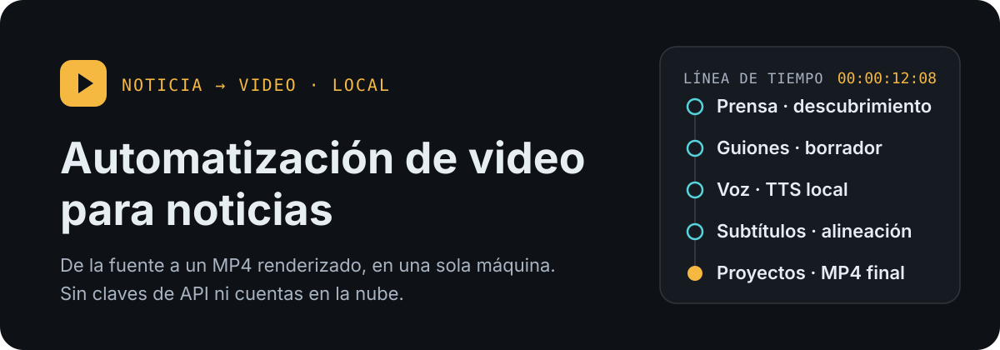
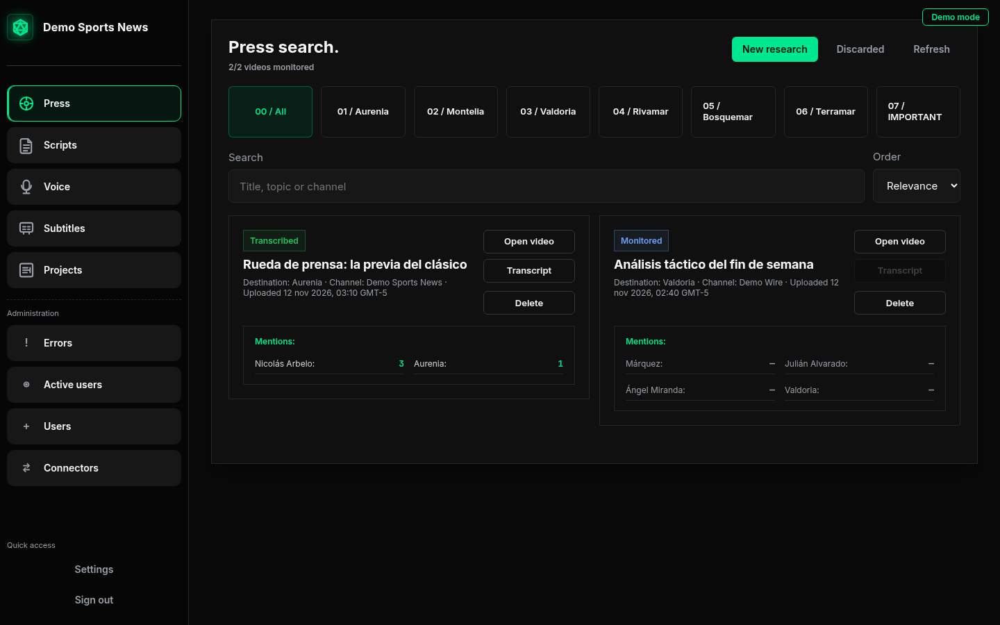
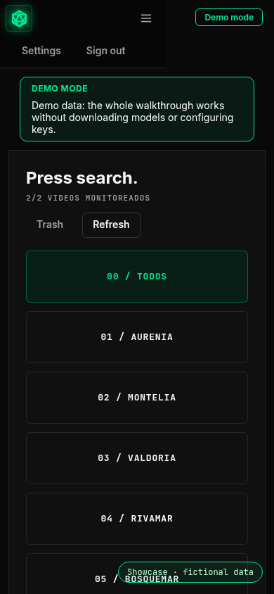
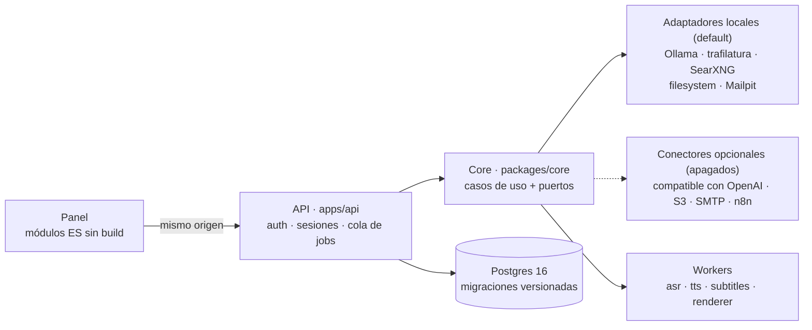

<p align="center"></p>

<p align="center"><b>Español</b> · <a href="README.en.md">English</a></p>

[](https://github.com/Eduardo12Pacheco/automatizacion-video-noticias/actions/workflows/ci.yml) [](LICENSE)

Pipeline de noticias local-first que lleva una historia desde el descubrimiento hasta un video renderizado, sin claves de API ni cuentas en la nube.


*Ejecución real en modo demo sobre la historia ficticia sembrada. El [MP4 de 67 segundos](docs/images/demo.mp4) recorre descubrimiento, aprobación, voz, subtítulos y proyectos.*

> Este proyecto se construyó con asistencia de IA: un agente de programación autónomo implementó la reconstrucción a partir de un documento de especificación revisado, con pruebas, verificación local y revisión humana en los puntos de decisión.

## Qué hace

Una señal de noticias se convierte en un video corto publicable en cinco etapas:

| Etapa | Qué ocurre |
|---|---|
| **Prensa** (descubrimiento) | Consulta feeds RSS públicos, extrae el texto de los artículos en local y agrupa historias relacionadas en temas de aprobación. |
| **Guiones** | Un editor aprueba un tema; el core redacta un guion, lo valida contra la fuente y guarda un borrador versionado. |
| **Voz** | Un motor TTS local narra el guion y deja el audio junto a él. |
| **Subtítulos** | Transcribe o recibe audio, alinea los subtítulos y los quema sobre el video. |
| **Proyectos** (video) | Compone marca, overlays y subtítulos en un MP4 final con Remotion. |

Alrededor del pipeline hay un producto funcional: interfaz bilingüe ES/EN, login multiusuario con roles, sesiones, presencia, área de administración y tema claro/oscuro, todo detrás de una única API HTTP autenticada.

<table>
  <tr>
    <td width="50%"><br><sub><b>Guiones</b> · ES · escritorio</sub></td>
    <td width="50%"><br><sub><b>Guiones</b> · EN · escritorio</sub></td>
  </tr>
  <tr>
    <td><br><sub><b>Prensa</b> · EN · escritorio</sub></td>
    <td><br><sub><b>Prensa</b> · ES · tema claro</sub></td>
  </tr>
</table>

<p align="center">
  
  
</p>

Todas las vistas, en español e inglés, en escritorio y móvil: [docs/SCREENSHOTS.md](docs/SCREENSHOTS.md).

## Por qué es distinto

- **Cero claves, cero nube.** El stack por defecto no necesita claves de API ni cuentas en la nube. Todo servicio externo es opcional y está desactivado por defecto.
- **Núcleo hexagonal.** Las reglas de dominio que vivían en Code nodes de n8n son casos de uso probados detrás de puertos, así que cualquier adaptador puede reemplazarse ([ADR](docs/adr/)).
- **Dos modos reales.** `demo` es determinista e instantáneo; `local` ejecuta modelos reales y produce medios reales.
- **Seguridad por defecto.** Los puertos se enlazan a loopback, las contraseñas se guardan como hashes bcrypt, las sesiones son HTTP-only, cada mutación pasa por un control de rol y una verificación de Origin de confianza, y los blobs se sirven en sandbox ([SECURITY.md](SECURITY.md)).
- **Las mismas verificaciones que CI.** `pnpm test:all` (o `newsroom test`) ejecuta las suites que corre CI.

## Local-first por defecto

| Capacidad | Default local (sin claves) | Opcional |
|---|---|---|
| Guiones | **Ollama** (`qwen2.5:3b-instruct`) | Cualquier endpoint compatible con OpenAI |
| Extracción de artículos | **trafilatura** | — |
| Búsqueda de imágenes | **SearXNG** + Wikimedia Commons | — |
| Base de datos | **Postgres** 16, migraciones versionadas | Cualquier Postgres vía `DATABASE_URL` |
| Blobs | Filesystem local | Compatible con S3 (probado con MinIO) |
| Voz | faster-whisper (ASR), **Piper** (CPU) o Qwen3-TTS (GPU), **yt-dlp** para descargas | — |
| Notificaciones | Consola, **Mailpit** | SMTP / Gmail |
| Orquestación | Cola y scheduler en proceso | Perfil n8n |
| Video | **Remotion** | — |

Variables de cada conector y mapa completo de puertos: [docs/CONNECTORS.md](docs/CONNECTORS.md).

## Arquitectura de un vistazo



Límites de componentes, flujos de peticiones y mapa completo de puertos y adaptadores: [docs/ARCHITECTURE.md](docs/ARCHITECTURE.md).

## Dos modos reales

El instalador pregunta qué modo usar, y `newsroom mode demo|local` permite cambiarlo después. El **modo demo** es determinista e instantáneo; el **modo local** ejecuta los modelos y medios locales reales. El camino demo corre en cada push; el camino local tiene un job de CI nocturno o manual que valida los medios reales. El panel muestra siempre el badge **Modo demo / Demo mode** cuando los adaptadores demo están activos, para que una captura nunca pase por una ejecución real de IA.

| Modo | Qué corre | Ideal para |
|---|---|---|
| `demo` (default) | Adaptadores deterministas, historia ficticia sembrada, sin descargas | Primera mirada y el camino feliz del navegador |
| `local` | Ollama, trafilatura, Piper, faster-whisper `small` int8 y un MP4 de 720p con Remotion en CPU | Una ejecución offline real |
| `local --gpu` | El mismo pipeline con Ollama, Whisper y Qwen3-TTS en una GPU NVIDIA (probado en una RTX 4060 de 8 GB) | Mejor voz y LLM, no menos tiempo total |

Medido con `e2e/local-mode.spec.js` en una sola máquina, del descubrimiento al MP4 final ([detalle](docs/INSTALL.md#ejecución-gpu-verificada)):

| | Borrador | Voz | Subtítulos | Render | Spec completa |
|---|---|---|---|---|---|
| CPU | 22.3 s | 17.8 s (Piper) | 46.5 s | 177.3 s | 5.2 min |
| GPU | 5.1 s | 90.1 s (Qwen3-TTS) | 44.9 s | 188.7 s (CPU) | 6.1 min |

## Instalar con un comando

Linux:

```bash
git clone https://github.com/Eduardo12Pacheco/automatizacion-video-noticias.git
cd automatizacion-video-noticias
./install.sh
```

Windows 10/11 (PowerShell 5.1+ o 7):

```powershell
git clone https://github.com/Eduardo12Pacheco/automatizacion-video-noticias.git
cd automatizacion-video-noticias
.\install.ps1
```

El instalador verifica Docker, disco, RAM y puertos, pregunta el modo (`demo` por defecto) y si se usa una GPU NVIDIA, genera un `.env` con secretos aleatorios nuevos, ejecuta las migraciones, crea el primer administrador y levanta el stack. Termina con la URL del panel (**http://127.0.0.1:8080**) y la contraseña de un solo uso del administrador. Volver a ejecutarlo repara o actualiza la instalación; las opciones desatendidas (`--yes --mode demo`, `--port 8090`) están en [docs/INSTALL.md](docs/INSTALL.md).

```bash
newsroom status      # qué está corriendo
newsroom doctor      # Docker, GPU, modelos, puertos, disco
newsroom logs api    # seguir un servicio
newsroom mode local  # cambiar de modo y reiniciar
newsroom test        # ejecutar las mismas suites que CI
newsroom down
```

`docker compose up` por sí solo falla a propósito hasta que el instalador genera `.env`. El flujo manual con Compose, el acceso desde la LAN y la ejecución del E2E de navegador están en [docs/INSTALL.md](docs/INSTALL.md) y [e2e/README.md](e2e/README.md).

## Historia del proyecto

La versión original funcionó unos tres meses en una redacción real, sobre n8n, Supabase y varias claves de API de pago. Validó el flujo y dejó la lección de que lo interesante era el pipeline editorial, no las cuentas en la nube. Este repositorio es una reconstrucción desde cero con un valor por defecto local-first; el despliegue privado no está en marcha y no se enlaza desde aquí. Más detalles en [docs/PROJECT.md](docs/PROJECT.md).

## Alcance honesto

- Este repositorio es una **reconstrucción de portafolio**, no un sistema en producción. Está pensado para instalarse y ejecutarse localmente; nada se despliega en internet.
- Todavía no hay releases publicados. El código está disponible desde la rama `main`.
- Los dos modos son reales y están probados. La demo grabada es el modo `demo`, y el panel lo indica así.
- Linux se prueba en el runner `ubuntu-latest` de CI y en la máquina Arch/CachyOS del autor. El instalador de Windows está cubierto por el job `windows-latest` de CI y por pruebas de PowerShell 7 en Linux, pero no se ha ejecutado en un escritorio físico con Windows 10/11.
- El modo GPU está verificado en la RTX 4060 (8 GB) del autor y no es más rápido de punta a punta que CPU: la síntesis de Qwen pesa más y el render de Remotion sigue en CPU.
- La interfaz, la navegación y el área de administración están traducidas a ES/EN; el contenido editorial generado conserva a propósito su idioma de origen.

## Documentación

| Tema | Dónde |
|---|---|
| Límites de componentes y flujos de peticiones | [Arquitectura](docs/ARCHITECTURE.md) · [ADR](docs/adr/) |
| Instalación, perfiles, GPU, solución de problemas | [Guía de instalación](docs/INSTALL.md) |
| Integraciones opcionales | [Conectores](docs/CONNECTORS.md) |
| Esquema persistido | [Modelo de datos](docs/data-model.md) |
| Historia, alcance, stack y mapa del repositorio | [Contexto del proyecto](docs/PROJECT.md) |
| Todas las vistas, ES/EN, escritorio y móvil | [Capturas](docs/SCREENSHOTS.md) |
| Pruebas y convenciones | [Contribuir](CONTRIBUTING.md) |
| Modelo de amenazas y reporte de vulnerabilidades | [Política de seguridad](SECURITY.md) |
| Origen de medios y licencias de fuentes | [Manifiesto de assets](ASSETS.md) |

## Licencia

[MIT](LICENSE) © Eduardo Pacheco. Los medios de marca de este repositorio son ficticios y se generan por código; consulta [ASSETS.md](ASSETS.md) para conocer sus orígenes y las licencias de las fuentes. El renderer usa [Remotion](https://www.remotion.dev/), gratuito para personas y equipos pequeños: revisa su licencia antes de cualquier uso comercial.
