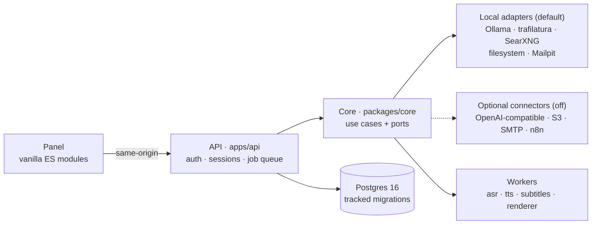

# Newsroom Video Automation

**English** · [Español](README.es.md)

[](https://github.com/Eduardo12Pacheco/newsroom-video-automation/actions/workflows/ci.yml)
[](LICENSE)
[](#local-first-by-default)

**A local-first newsroom pipeline that takes a story from discovery to a rendered video, with no API key and no cloud account.**

> This project was built with AI assistance: an autonomous coding agent implemented the rebuild from a reviewed feature document, with tests, local verification and human review at the decision points.

[Quickstart](#run-it-in-one-command) · [Architecture](#architecture-at-a-glance) · [Run modes](#two-real-run-modes) · [Honest scope](#honest-scope) · [Docs](#documentation)


*A real demo-mode run on the seeded fictional story. The [67-second MP4](docs/images/demo.mp4) covers discovery, approval, voice, subtitles and projects.*

## What it does

A news signal becomes a publishable short video in five stages:

| Stage | What happens |
|---|---|
| **Prensa** (discovery) | Polls public RSS feeds, extracts article text locally and groups related stories into approval topics. |
| **Guiones** (scripts) | An editor approves a topic; the core drafts a script, checks it against the source and stores a versioned draft. |
| **Voz** (voice) | A local TTS engine narrates the script and keeps the audio beside it. |
| **Subtítulos** (subtitles) | Transcribes or accepts audio, aligns captions and burns them onto video. |
| **Proyectos** (video projects) | Composes brand package, overlays and captions into a final MP4 with Remotion. |

Around the pipeline sits a real product shell: bilingual ES/EN UI, role-based multi-user login, sessions, presence, an admin area and a light/dark theme, all behind one authenticated HTTP API.

<table>
  <tr>
    <td width="50%"><br><sub><b>Guiones</b> · ES · desktop</sub></td>
    <td width="50%"><br><sub><b>Guiones</b> · EN · desktop</sub></td>
  </tr>
  <tr>
    <td><br><sub><b>Prensa</b> · EN · desktop</sub></td>
    <td><br><sub><b>Prensa</b> · ES · light theme</sub></td>
  </tr>
</table>

<p align="center">
  
  
</p>

Every view, in Spanish and English, desktop and mobile: [docs/SCREENSHOTS.md](docs/SCREENSHOTS.md).

## Highlights

- **Zero keys, zero cloud.** The default stack needs no API key and no cloud account; every external service is optional and off by default.
- **Hexagonal core.** The domain rules that lived in n8n Code nodes are now tested use cases behind ports, so any adapter is swappable ([ADRs](docs/adr/)).
- **Two real run modes.** `demo` is deterministic and instant; `local` runs real models and produces real media.
- **Secure defaults.** Loopback-only ports, bcrypt hashes with HTTP-only sessions, one role gate plus a trusted-Origin check on every mutation, sandboxed blob serving ([SECURITY.md](SECURITY.md)).
- **Tested like a product.** `pnpm test:all` runs the same suites as CI: 28 of 30 pass, 0 failures, 2 allow-listed skips (the two E2E suites run in their own CI jobs).

## Local-first by default

| Capability | Local default (no key) | Optional |
|---|---|---|
| Script writing | **Ollama** (`qwen2.5:3b-instruct`) | Any OpenAI-compatible endpoint |
| Article extraction | **trafilatura** | — |
| Image search | **SearXNG** + Wikimedia Commons | — |
| Database | **Postgres** 16, tracked migrations | Any Postgres via `DATABASE_URL` |
| Blobs | Local filesystem | S3-compatible (MinIO-tested) |
| Speech | faster-whisper (ASR), **Piper** (CPU) or Qwen3-TTS (GPU), **yt-dlp** for downloads | — |
| Notifications | Console, **Mailpit** | SMTP / Gmail |
| Orchestration | In-process queue and scheduler | n8n profile |
| Video | **Remotion** | — |

Connector switches and the full port map: [docs/CONNECTORS.md](docs/CONNECTORS.md).

## Architecture at a glance



Component boundaries, request flows and the full port/adapter map: [docs/ARCHITECTURE.md](docs/ARCHITECTURE.md).

## Two real run modes

The installer asks which mode to use and `newsroom mode demo|local` switches later. Demo mode is deterministic and instant; local mode runs the real local models and media. The demo path runs on every push; the local path has a nightly/manual CI job that asserts the real media. The panel always shows a **Modo demo / Demo mode** badge when the demo adapters are active, so a screenshot can never pass as a real AI run.

| Mode | What runs | Best for |
|---|---|---|
| `demo` (default) | Deterministic stub adapters, seeded fictional story, no downloads | A first look and the browser happy path |
| `local` | Ollama, trafilatura, Piper, faster-whisper `small` int8 and a real Remotion 720p MP4 on CPU | A real offline run |
| `local --gpu` | The same pipeline with Ollama, Whisper and Qwen3-TTS on an NVIDIA GPU (tested on an 8 GB RTX 4060) | Better voice and LLM, not less total time |

Measured with `e2e/local-mode.spec.js` on one machine, from discovery to the final MP4 ([details](docs/INSTALL.md#verified-gpu-run)):

| | Script draft | Voice | Subtitles | Render | Whole spec |
|---|---|---|---|---|---|
| CPU | 22.3 s | 17.8 s (Piper) | 46.5 s | 177.3 s | 5.2 min |
| GPU | 5.1 s | 90.1 s (Qwen3-TTS) | 44.9 s | 188.7 s (CPU) | 6.1 min |

## Run it in one command

Linux:

```bash
git clone https://github.com/Eduardo12Pacheco/newsroom-video-automation.git
cd newsroom-video-automation
./install.sh
```

Windows 10/11 (PowerShell 5.1+ or 7):

```powershell
git clone https://github.com/Eduardo12Pacheco/newsroom-video-automation.git
cd newsroom-video-automation
.\install.ps1
```

The installer checks Docker, disk, RAM and ports, asks for the run mode (`demo` by default) and whether to use an NVIDIA GPU, writes a `.env` with fresh random secrets, runs the migrations, creates the first administrator and starts the stack. It ends with the panel URL (**http://127.0.0.1:8080**) and the one-time administrator password. Re-running it repairs or upgrades the installation; unattended flags (`--yes --mode demo`, `--port 8090`) are in [docs/INSTALL.md](docs/INSTALL.md).

```bash
newsroom status      # what is running
newsroom doctor      # Docker, GPU, models, ports, disk
newsroom logs api    # follow one service
newsroom mode local  # switch run mode and restart
newsroom test        # run the same suites as CI
newsroom down
```

`docker compose up` alone fails by design until the installer has generated `.env`. The manual Compose flow, LAN access and the browser E2E run are in [docs/INSTALL.md](docs/INSTALL.md) and [e2e/README.md](e2e/README.md).

## Project story

The original version ran for about three months in a real newsroom, on n8n, Supabase and several paid API keys. It proved the workflow and taught the lesson that the interesting part was the editorial pipeline, not the cloud accounts. This repository is a ground-up rebuild with a local-first default; the private deployment is not running and is not linked from here. More in [docs/PROJECT.md](docs/PROJECT.md).

## Honest scope

- This repository is a **portfolio rebuild**, not a live system. It is designed to be installed and run locally; nothing is deployed to the internet.
- Both run modes are real and tested. The recorded demo is `demo` mode, and the panel labels it as such.
- Linux is tested on the CI `ubuntu-latest` runner and on the author's Arch/CachyOS machine. The Windows installer is covered by the `windows-latest` CI job and PowerShell 7 tests on Linux, but has not been run on a physical Windows 10/11 desktop.
- GPU mode is verified on the author's RTX 4060 (8 GB) and is not faster end to end than CPU: Qwen synthesis is heavier and the Remotion render stays on CPU.
- UI chrome, navigation and the admin area are translated ES/EN; generated editorial content intentionally keeps its source language.

## Documentation

| Topic | Where |
|---|---|
| Component boundaries, request flows | [Architecture](docs/ARCHITECTURE.md) · [ADRs](docs/adr/) |
| Install, profiles, GPU, troubleshooting | [Install guide](docs/INSTALL.md) |
| Optional integrations | [Connectors](docs/CONNECTORS.md) |
| Persisted schema | [Data model](docs/data-model.md) |
| Story, scope, tech stack, repository map | [Project background](docs/PROJECT.md) |
| Every view, ES/EN, desktop and mobile | [Screenshots](docs/SCREENSHOTS.md) |
| Tests and conventions | [Contributing](CONTRIBUTING.md) |
| Threat model, reporting | [Security policy](SECURITY.md) |
| Media origins, font licenses | [Asset manifest](ASSETS.md) |

## License

[MIT](LICENSE) © Eduardo Pacheco. Brand media in this repository is fictional and generated by code; see [ASSETS.md](ASSETS.md) for origins and font licenses. The renderer uses [Remotion](https://www.remotion.dev/), which is free for individuals and small teams: check its license before any commercial use.
