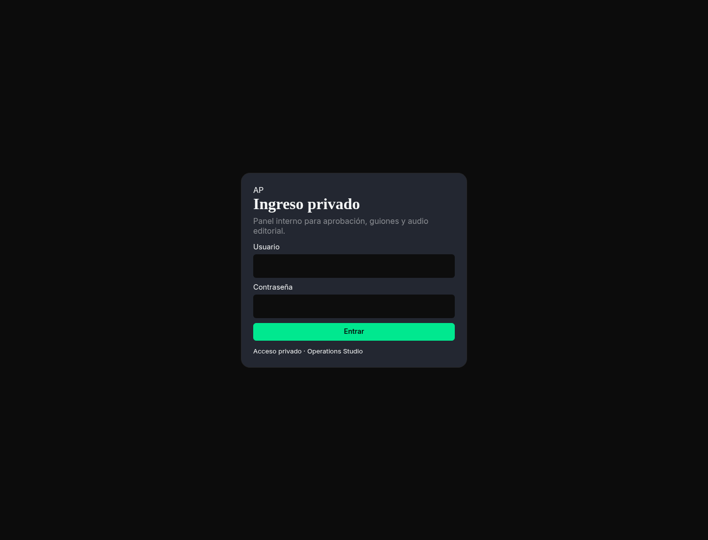
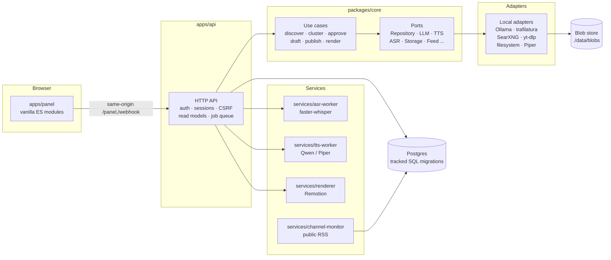

# Newsroom Video Automation

**A local-first newsroom pipeline that takes a story from discovery to a rendered video without an API key or a cloud account.**

*Read this in [Spanish](README.es.md).*


The clip above is a short loop of the panel in showcase mode (`/?showcase=1`,
fictional seeded data): pipeline navigation, the approval/Guiones view, Prensa,
Voz, Subtítulos, Proyectos and Settings. The [MP4](docs/images/demo.mp4) is the
full 34-second walkthrough.

| Panel · Guiones | Panel · Prensa |
|---|---|
|  |  |

## What it does

The product turns a news signal into a publishable short video:

1. **Prensa (news discovery)** polls public RSS feeds, extracts article text
   locally and groups related stories into approval topics.
2. **Guiones (scripts)** lets an editor approve a topic; the core drafts a
   script, checks it against the source and stores a versioned draft.
3. **Voz (voice)** renders narration with a local TTS engine and keeps the
   audio beside the script.
4. **Subtítulos (subtitles)** transcribes or accepts audio, aligns captions and
   renders them onto video.
5. **Proyectos (video projects)** composes the brand package, overlays and
   captions into a final MP4 through Remotion.

Around the pipeline there is a real product shell: bilingual ES/EN UI,
role-based multi-user login, presence, an admin screen, an approval inbox and
an authenticated HTTP API that owns every browser request.

## Architecture



See [docs/ARCHITECTURE.md](docs/ARCHITECTURE.md) for the component boundaries,
the port/adapter map and the request flow. The key decisions are recorded as
[ADRs](docs/adr/).

## Stack

| Layer | Choice | Why |
|---|---|---|
| UI | Vanilla HTML, CSS and ES modules | No build step, keeps the panel easy to inspect |
| API | Node.js on `apps/api` | One backend owns auth, sessions, read models and the job queue |
| Domain | `packages/core` use cases + `packages/contracts` | The n8n business rules are ordinary, tested code |
| Data | Postgres 16 + tracked SQL migrations | Same engine as Supabase, but self-hosted and disposable in tests |
| Local AI | Ollama (OpenAI-compatible API), faster-whisper, Qwen TTS / Piper | Runs on the same machine; CPU fallbacks exist |
| Video | Remotion (React-based renderer) | Programmatic, role-based brand compositions |
| Packaging | Docker Compose + `install.sh` / `install.ps1` + `newsroom` CLI | One install path for Linux and Windows |

## Local-first by default

The default configuration needs **zero API keys and zero cloud accounts**.
Every external capability is behind a port with a local adapter, and external
services are optional and off by default.

| Capability | Local default | Optional adapter |
|---|---|---|
| Script writing / clustering | **Ollama** (`qwen2.5:3b-instruct` by default, any local model) | Any OpenAI-compatible endpoint through `.env` |
| Article extraction | **trafilatura** (fetch + main-text extraction) | — |
| Image search | **SearXNG** container + Wikimedia Commons (no key) | — |
| Database | **Postgres** 16 container with tracked migrations | Point `DATABASE_URL` at any Postgres |
| Blob storage | Local filesystem served by the API | S3-compatible storage |
| Speech to text | **faster-whisper** in `asr-worker` (GPU, CPU fallback) | — |
| Text to speech | Qwen TTS (GPU) with **Piper** CPU fallback | — |
| Media download | **yt-dlp** on the host/container | — |
| Notifications | Console adapter | **Mailpit** for local mail; SMTP for a real inbox |
| Orchestration | In-process job queue + scheduler | Optional **n8n** profile with slim workflows |
| Connectors | Local adapters, no keys | SMTP/Gmail, OpenAI-compatible LLM, S3/MinIO, n8n — see [`docs/CONNECTORS.md`](docs/CONNECTORS.md) |
| Export | python-docx `.docx` + Markdown | — |

The GPU workers share a cross-process slot so an 8 GB card never loads the LLM,
Whisper and TTS at the same time.

## Quick start (one command)

Linux / macOS:

```bash
git clone https://github.com/<your-account>/newsroom-video-automation.git
cd newsroom-video-automation
./install.sh
```

Windows 10/11:

```powershell
git clone https://github.com/<your-account>/newsroom-video-automation.git
cd newsroom-video-automation
.\install.ps1
```

The installer asks for the run mode (`demo`, the default, or `local`) and, when
it finds an NVIDIA GPU, whether to use it; then it checks Docker, disk, RAM and
ports, writes a `.env` with fresh random secrets, runs the migrations, creates
the first administrator and starts the stack. It ends with a summary box with
the panel URL, the administrator, the generated password and the stop/start
commands. The default `demo` mode needs no models; `local` downloads Ollama,
Piper and faster-whisper models once.

For unattended installs use the flags: `./install.sh --yes --mode demo` or
`./install.sh --yes --mode local --no-gpu` (PowerShell: `-Yes -Mode demo`,
`-Mode local -NoGpu`). `--port 8090` changes the published panel port.
Re-running the installer repairs or upgrades the installation.

| Mode | What runs | Panel label |
|---|---|---|
| `demo` | deterministic stub adapters, seeded fictional story | **Modo demo / Demo mode** |
| `local` | Ollama script writing, trafilatura extraction, Piper voice, faster-whisper subtitles and a Remotion 720p MP4 on CPU | real local run |

Then use the control CLI:

```bash
newsroom status      # what is running
newsroom doctor      # Docker, GPU, models, ports, disk
newsroom logs api    # follow one service
newsroom mode local  # switch run mode and restart
newsroom test        # run the same suites as CI
newsroom down
```

The panel is served at **http://127.0.0.1:8080**. The detailed path, including
the manual `docker compose` flow and LAN access, is in [docs/INSTALL.md](docs/INSTALL.md).

The demo profile is also the keyless stack used by the browser test:

```bash
cp e2e/.env.example .env
docker compose up -d --build postgres searxng mailpit demo-worker api panel
docker compose run --rm seed
pnpm install --frozen-lockfile
pnpm exec playwright test
```

## Repository map

```text
apps/
  api/                 HTTP API, auth, sessions, job queue, composition root
  panel/               Vanilla ES-module editorial UI
packages/
  contracts/           Shared contract helpers
  core/                Use cases and ports (the domain)
  data/                Repository + blob ports, Postgres and in-memory adapters
  adapters/            Local-first adapters for every external capability
services/
  asr-worker/          faster-whisper GPU/CPU service
  tts-worker/          Qwen GPU + Piper CPU TTS
  renderer/            Remotion final renderer
  subtitles/           Caption alignment and burn-in
  channel-monitor/     Public RSS channel monitoring
  demo-worker/         Deterministic keyless worker for the demo profile
infra/
  db/migrations/       Tracked SQL schema
  n8n/                 Optional n8n profile
  install/             Shared installer library and tests
  windows/             Optional Windows service helpers
docs/                  Architecture, ADRs, install guide, data model
examples/              Fictional brand assets and n8n reference export
tools/                 Asset generator and structural tests
```

## Testing

Run the same suites CI runs, with a summary table, using one command:

```bash
pnpm install --frozen-lockfile
pnpm test:all
```

It covers every Node package, the panel pytest suite and its 46 `__checks__`
scripts, each Python service, the tools tests, installer tests and the Compose
config. The Playwright demo E2E needs the running stack, so run it after
`docker compose up` with `NEWSROOM_E2E=1 pnpm test:all` (CI does this in its
own job). Focused examples:

```bash
pnpm test:panel
pnpm test:checks
node --test apps/api/test
uv run --project services/asr-worker --with pytest --with httpx pytest services/asr-worker/tests -q
pnpm exec playwright test
```

Every suite is blocking in CI; there are no `continue-on-error` baselines.

## Honest scope

- This repository is a **portfolio rebuild**, not a live system. It is designed
  to be installed and run locally, and nothing is deployed to the internet.
- The original private deployment depended on n8n, Supabase and several API
  keys. Those paths are now local adapters; the historical n8n export is kept
  only as a reference fixture under `examples/legacy-n8n/`.
- The default CPU demo uses deterministic adapters for the worker-facing steps
  so a visitor can click through the whole flow without a GPU or a model pull.
  The real local Ollama / Whisper / Qwen / Piper paths are available behind the
  `gpu` profile and the installer.
- Some deep feature labels and generated content values are still in their
  source language; the shell, navigation and admin screens are fully ES/EN.
- This project was built with AI assistance: an autonomous coding agent
  implemented the rebuild from a reviewed feature document, with tests, local
  verification and human review at the decision points.

## Remotion license

The renderer uses [Remotion](https://www.remotion.dev/). Remotion is free for
individuals and small teams; check its license before any commercial use.

## Documentation

- [Architecture](docs/ARCHITECTURE.md)
- [Architecture decision records](docs/adr/)
- [Install guide](docs/INSTALL.md)
- [Data model](docs/data-model.md)
- [Asset manifest](ASSETS.md)
- [Spanish README](README.es.md)

## License

[MIT](LICENSE) © Eduardo Pacheco. Brand media in this repository is fictional
and generated by code; see [ASSETS.md](ASSETS.md) for origins and font licenses.
