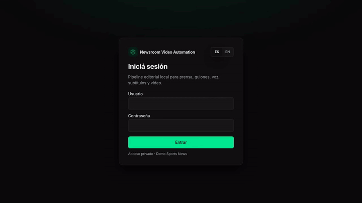
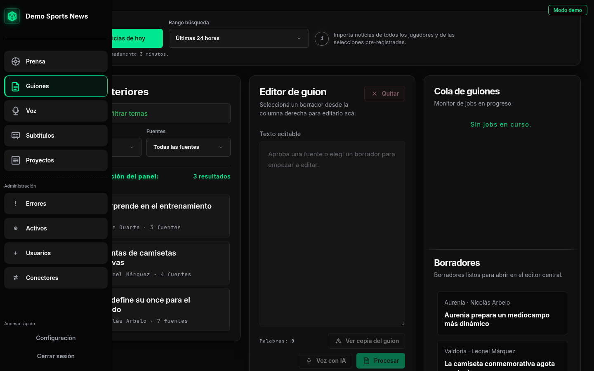
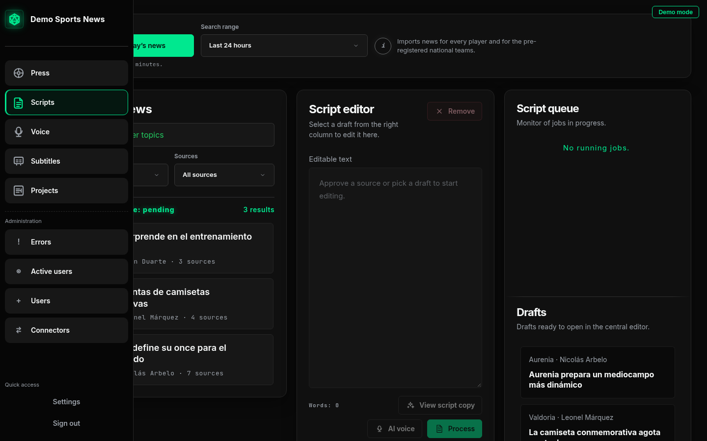
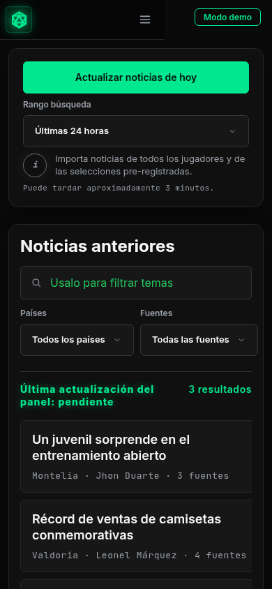
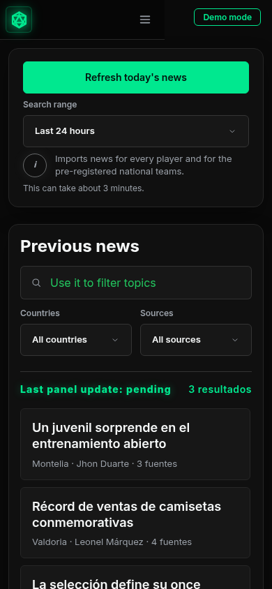
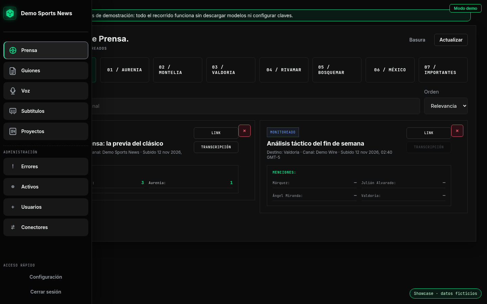
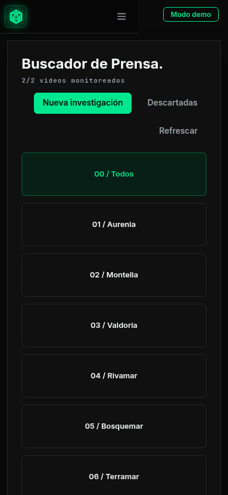
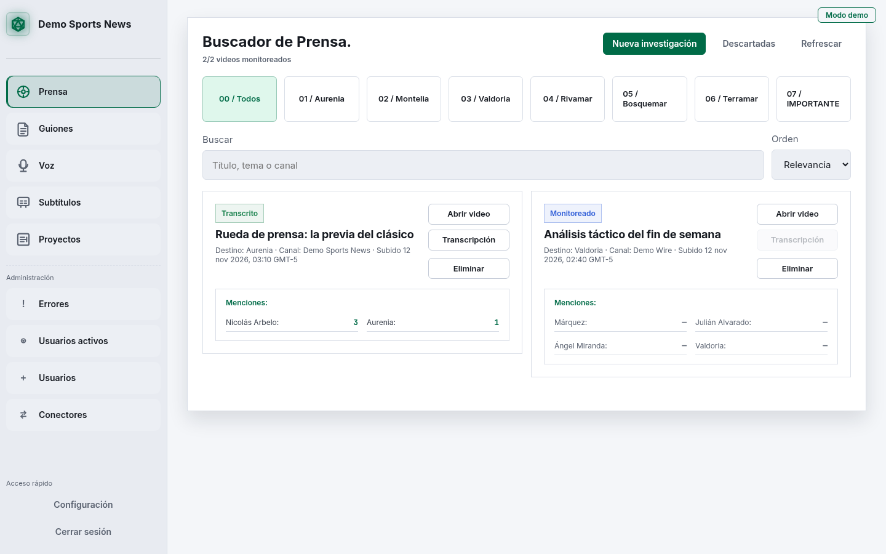
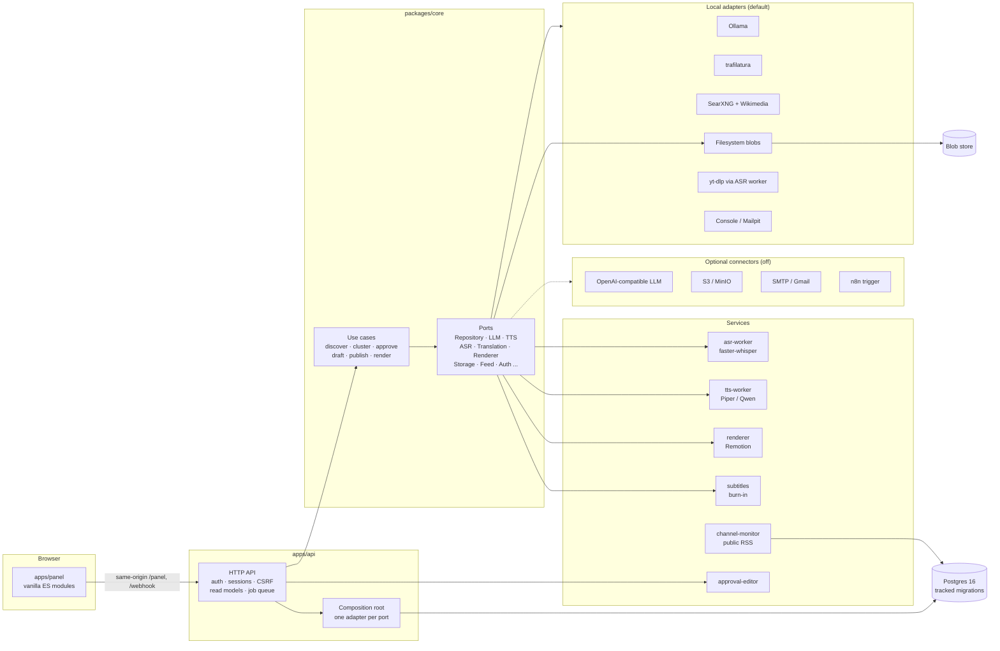

# Newsroom Video Automation

[](https://github.com/Eduardo12Pacheco/newsroom-video-automation/actions/workflows/ci.yml)
[](LICENSE)
[](#local-first-by-default)

*This project was built with AI assistance: an autonomous coding agent
implemented the rebuild from a reviewed feature document, with tests, local
verification and human review at the decision points.*

**A local-first newsroom pipeline that takes a story from discovery to a
rendered video without an API key or a cloud account.**

*Read this in [Spanish](README.es.md).*



The clip above is a short loop of a real demo-mode run; the
[MP4](docs/images/demo.mp4) is the full 67-second walkthrough through
discovery, approval, voice, subtitles and projects, including a real demo voice
job finishing at 100 %. Both were recorded from the running stack with the
seeded fictional story, not from a design mock.

| Guiones · ES · desktop | Guiones · EN · desktop |
|---|---|
|  |  |

| Guiones · ES · mobile | Guiones · EN · mobile |
|---|---|
|  |  |

| Prensa · ES · desktop | Prensa · EN · desktop |
|---|---|
|  |  |

| Prensa · ES · mobile | Prensa · EN · mobile |
|---|---|
|  |  |

| Prensa · ES · light theme |
|---|
|  |

More desktop and mobile shots for every view, in Spanish and English, live in
[`docs/images/screens/`](docs/images/screens/) and are captured by the visual-QA
suite.

## What it does

The product turns a news signal into a publishable short video:

1. **Prensa (news discovery)** polls public RSS feeds, extracts article text
   locally and groups related stories into approval topics.
2. **Guiones (scripts)** lets an editor approve a topic; the core drafts a
   script, checks it against the source and stores a versioned draft.
3. **Voz (voice)** renders narration with a local TTS engine and keeps the
   audio beside the script.
4. **Subtítulos (subtitles)** transcribes or accepts audio, aligns captions and
   burns them onto video.
5. **Proyectos (video projects)** composes the brand package, overlays and
   captions into a final MP4 through Remotion.

Around the pipeline there is a real product shell: bilingual ES/EN UI,
role-based multi-user login, sessions, presence, an admin area, approval and
connector screens, a light/dark theme, and an authenticated HTTP API that owns
every browser request.

## Architecture



See [docs/ARCHITECTURE.md](docs/ARCHITECTURE.md) for the component boundaries,
the full port/adapter map and the request flows. The key decisions are recorded
as [ADRs](docs/adr/).

## Two real run modes

The installer asks which mode to use, and `newsroom mode demo|local` switches
later. Demo mode is deterministic and instant; local mode runs the real local
models and media. The demo path runs on every push; the local path has a
nightly/manual CI job that asserts the real media.

| Mode | What runs | Models | Best for |
|---|---|---|---|
| `demo` (default) | Deterministic stub adapters, seeded fictional story, no downloads | None | A first look, screenshots, the browser happy path |
| `local` | Ollama script writing (`qwen2.5:3b-instruct`), trafilatura extraction, Piper Spanish voice, faster-whisper `small` int8 subtitles and a real Remotion 720p MP4 on CPU | Ollama, Whisper and Piper | A real offline run |
| `local --gpu` | The same pipeline with Ollama, Whisper and Qwen3-TTS on an NVIDIA GPU | The same plus the Qwen3-TTS 1.7B checkpoint (~4.5 GB) | An NVIDIA machine (tested on an 8 GB RTX 4060); better voice and LLM, not less total time |

The panel always shows a **Modo demo / Demo mode** badge when the demo adapter
set is active, so a screenshot cannot be mistaken for a real AI run. Whisper and
TTS share one cross-process GPU slot, and the GPU profile makes Ollama unload
the LLM immediately after each request, so an 8 GB card can run the 3B LLM and
the 1.7B voice model back to back without both staying resident.

### Measured pipeline timings

Both rows are the same `e2e/local-mode.spec.js` run on one machine (RTX 4060
8 GB laptop GPU, 12 cores, 31 GB RAM): CPU is the reference and `--gpu` keeps the
Remotion render on CPU. The numbers include the whole spec from discovery to the
final MP4, not a micro-benchmark.

| Stage | CPU | GPU |
|---|---|---|
| Ollama script draft | 22.3 s | 5.1 s |
| Voice | 17.8 s (Piper) | 90.1 s (Qwen3-TTS 1.7B) |
| faster-whisper subtitles | 46.5 s | 44.9 s |
| Remotion render | 177.3 s (CPU) | 188.7 s (CPU) |
| Whole spec | 5.2 min | 6.1 min |

## Local-first by default

The default configuration needs **zero API keys and zero cloud accounts**.
Every external capability is behind a port with a local adapter, and external
services are optional and off by default.

| Capability | Local default | Optional adapter |
|---|---|---|
| Script writing / clustering | **Ollama** (`qwen2.5:3b-instruct`, any local model) | Any OpenAI-compatible endpoint |
| Article extraction | **trafilatura** (fetch + main-text extraction) | — |
| Image search | **SearXNG** container + Wikimedia Commons (no key) | — |
| Database | **Postgres** 16 container with tracked migrations | Point `DATABASE_URL` at any Postgres |
| Blob storage | Local filesystem served by the API | S3-compatible storage (MinIO-tested) |
| Speech to text | **faster-whisper** in `asr-worker` (CPU int8, GPU optional) | — |
| Text to speech | **Piper** CPU voice; Qwen on GPU | — |
| Media download | **yt-dlp** in the ASR worker | — |
| Notifications | Console adapter | **Mailpit** locally; SMTP/Gmail for a real inbox |
| Orchestration | In-process job queue + scheduler | Optional **n8n** profile with two slim workflows |
| Export | python-docx `.docx` + Markdown | — |

## Connectors

Every integration is an adapter behind a port, selectable from `.env`, listed
in **Administración → Conectores** with its live status, and documented in
[`docs/CONNECTORS.md`](docs/CONNECTORS.md).

| Connector | Env switch | Default | What it does |
|---|---|---|---|
| Ollama / any OpenAI-compatible LLM | `LLM=ollama\|openai` | Local Ollama | Scripts, clustering, classification |
| SMTP / Gmail | `NOTIFY=smtp` | Console | Notification e-mail (Gmail uses an app password) |
| S3 / MinIO | `STORAGE=s3` | Filesystem | Blob storage for uploads and renders |
| n8n | `WORKFLOW=n8n` | Disabled | Cron trigger (`POST /jobs/discover`) and job-completed webhook |

All optional connectors are off by default; their credentials come from `.env`
and are never returned by the API or committed to the repository.

## Security model

Published ports bind to `127.0.0.1` by default, users live in Postgres with
bcrypt hashes and HTTP-only sessions, and every mutating route passes one role
gate with a trusted-Origin check. The one authenticated route that is not
role-gated is `POST /panel/presence/heartbeat`: it only writes ephemeral
presence state, never domain data. Login throttling keys on the username plus
the client IP, and `X-Forwarded-For` is trusted only from the panel container's
own address. Uploaded blobs are served with a sandbox CSP and `nosniff`; only
audio, video and raster images may render inline, while HTML, SVG and XML are
forced to `application/octet-stream` downloads. The full list and the threat
model are in [SECURITY.md](SECURITY.md).

## Tech stack

| Layer | Choice | Why |
|---|---|---|
| UI | Vanilla HTML, CSS and ES modules | No build step, easy to inspect in the browser |
| API | Node.js in `apps/api` | One backend owns auth, sessions, read models and the job queue |
| Domain | `packages/core` use cases + `packages/contracts` | The original n8n rules are ordinary, tested code |
| Data | Postgres 16 + tracked SQL migrations | Same engine as Supabase, self-hosted and disposable in tests |
| Local AI | Ollama, trafilatura, faster-whisper, Piper/Qwen | Runs on one machine, with CPU fallbacks |
| Video | Remotion | Programmatic, role-based brand compositions |
| Packaging | Docker Compose + `install.sh` / `install.ps1` + `newsroom` CLI | One install path for Linux and Windows |

## Run it in one command

Linux:

```bash
git clone https://github.com/Eduardo12Pacheco/newsroom-video-automation.git
cd newsroom-video-automation
./install.sh
```

Windows 10/11 (PowerShell 5.1+ or 7):

```powershell
git clone https://github.com/Eduardo12Pacheco/newsroom-video-automation.git
cd newsroom-video-automation
.\install.ps1
```

The installer shows a banner, checks Docker, disk, RAM and ports, asks for the
run mode (`demo` by default) and, when it finds an NVIDIA GPU, whether to use
it. It then writes a `.env` with fresh random secrets, runs the migrations,
creates the first administrator, starts the stack and ends with a summary box:
panel URL, administrator, the one-time password, and the commands to stop,
start and inspect logs.

For unattended installs: `./install.sh --yes --mode demo` or
`./install.sh --yes --mode local --no-gpu` (PowerShell: `-Yes -Mode demo`,
`-Mode local -NoGpu`). `--port 8090` changes the published panel port. Re-running
the installer repairs or upgrades the installation.

Then use the control CLI:

```bash
newsroom status      # what is running
newsroom doctor      # Docker, GPU, models, ports, disk
newsroom logs api    # follow one service
newsroom mode local  # switch run mode and restart
newsroom test        # run the same suites as CI
newsroom down
```

The panel is served at **http://127.0.0.1:8080**. `docker compose up` alone
fails by design until the installer has generated `.env` with its secrets and
panel network; the `:?` messages in `compose.yaml` say so. The manual
`docker compose` flow, the debug profile and LAN access are documented in
[docs/INSTALL.md](docs/INSTALL.md).

The demo stack is also the keyless stack used by the browser test. Never copy
`e2e/.env.example` over an installed `.env`; point Compose at the committed E2E
environment instead:

```bash
export NEWSROOM_ENV_FILE=e2e/.env.example
export E2E_COMPOSE_ENV=e2e/.env.example
docker compose --env-file "$E2E_COMPOSE_ENV" up -d --build postgres searxng mailpit demo-worker api panel
docker compose --env-file "$E2E_COMPOSE_ENV" run --rm seed
pnpm install --frozen-lockfile
pnpm exec playwright install chromium
E2E_ALLOW_RESET=1 pnpm exec playwright test e2e/happy-path.spec.js e2e/panel-flows.spec.js
```

`E2E_ALLOW_RESET=1` is the explicit opt-in for the destructive panel-flow
reset (seeded story and E2E administrator password); set it only on a demo
stack created for the tests. `E2E_EDITOR_PASSWORD` overrides the seeded editor
password; without it the specs read `NEWSROOM_DEMO_PASSWORD` from the E2E
environment file. See [e2e/README.md](e2e/README.md).

## Project story

The original version of this product ran for about three months in a real
newsroom, with n8n as the backend, Supabase as the datastore and several paid
API keys for extraction, search and language models. It proved the workflow and
taught the expensive lesson: the interesting part was the editorial pipeline,
not the cloud accounts.

This repository is a ground-up rebuild of that system. The domain rules moved
from n8n Code nodes into tested use cases, the browser stopped talking to
Supabase, duplicate Whisper/RSS/download code was collapsed, the UI was rebuilt
around a design system, and every external capability became an optional
adapter behind a local-first default. The private deployment is not running and
is not linked from here.

## Repository map

```text
apps/
  api/                 HTTP API, auth, sessions, job queue, composition root
  panel/               Vanilla ES-module editorial UI
packages/
  contracts/           Shared contract helpers and editor schemas
  core/                Use cases and ports (the domain)
  data/                Repository + blob ports, Postgres/in-memory/S3 adapters
  adapters/            Local-first adapters and the optional connectors
services/
  asr-worker/          faster-whisper GPU/CPU service, yt-dlp download
  tts-worker/          Piper CPU + Qwen GPU TTS
  renderer/            Remotion final renderer
  subtitles/           Caption alignment and burn-in
  channel-monitor/     Public RSS channel monitoring
  demo-worker/         Deterministic keyless worker for the demo profile
infra/
  db/migrations/       Tracked SQL schema
  n8n/                 Optional n8n profile and two slim workflows
  install/             Shared installer library and tests
  windows/             Optional Windows service helpers
docs/                  Architecture, ADRs, install, connectors, data model
examples/              Fictional brand assets and the legacy n8n reference
tools/                 Asset generator, demo recorder and structural tests
```

## Testing

Run the same suites CI runs, with a summary table, using one command:

```bash
pnpm install --frozen-lockfile
pnpm test:all
```

It covers every Node package, the panel pytest suite and its 42 `__checks__`
scripts, each Python service, the tools tests, installer tests and the Compose
config: **28 of 30 suites pass, 0 failures, 2 allow-listed skips** on the current
revision (the demo E2E and the local-mode E2E need a running stack; CI runs both
in their own jobs, and `e2e/local-mode.spec.js` downloads the real models and
asserts the rendered audio, subtitles and MP4 with `ffprobe`). The visual-QA
suite runs without Docker against the showcase. Every suite is blocking in CI;
there are no `continue-on-error` baselines.

Focused examples:

```bash
pnpm test:panel
pnpm test:checks
node --test apps/api/test
uv run --project services/asr-worker --with pytest --with httpx pytest services/asr-worker/tests -q
pnpm exec playwright test e2e/happy-path.spec.js e2e/panel-flows.spec.js
```

See [CONTRIBUTING.md](CONTRIBUTING.md) for the full test matrix and conventions.

## Honest scope

- This repository is a **portfolio rebuild**, not a live system. It is designed
  to be installed and run locally; nothing is deployed to the internet.
- Both run modes are real and tested: `demo` is deterministic and needs no
  models; `local` runs the actual local models and produces real media on CPU.
  The recorded demo is the demo mode, and the panel labels it as such.
- Linux is tested on the CI `ubuntu-latest` runner and on the owner's
  Arch/CachyOS machine. The Windows installer is covered by the
  `windows-latest` CI job (parser, prerequisite check and dry-run) and by
  PowerShell 7 behaviour tests on Linux; it has not been exercised on a
  physical Windows 10/11 desktop.
- GPU mode is verified on the owner's machine (RTX 4060 8 GB, driver 620.70,
  `nvidia-container-toolkit`): `docker run --rm --gpus all nvidia/cuda:12.4.1-base-ubuntu22.04
  nvidia-smi` works, and the local-mode E2E passed with real CUDA Ollama,
  faster-whisper and Qwen3-TTS media. Peak GPU memory during that run was
  6,646 MB of 8,188 MB; the 1.7B voice variant fits because the LLM unloads
  immediately and GPU jobs are serialized. GPU mode is not faster end to end
  than CPU (Qwen synthesis is heavier and the Remotion render stays on CPU):
  the measured run took 6.1 min versus 5.2 min on CPU, while the LLM draft
  dropped from 22.3 s to 5.1 s.
- The UI chrome, navigation, admin area and every screen in the visual-QA suite
  are translated in ES/EN. Generated editorial content (news titles, scripts,
  player names) intentionally stays in its source language.

## Remotion license

The renderer uses [Remotion](https://www.remotion.dev/). Remotion is free for
individuals and small teams; check its license before any commercial use.

## Documentation

- [Architecture](docs/ARCHITECTURE.md)
- [Architecture decision records](docs/adr/)
- [Install guide](docs/INSTALL.md)
- [Connectors](docs/CONNECTORS.md)
- [Data model](docs/data-model.md)
- [Asset manifest](ASSETS.md)
- [Contributing](CONTRIBUTING.md)
- [Security policy](SECURITY.md)
- [Spanish README](README.es.md)

## License

[MIT](LICENSE) © Eduardo Pacheco. Brand media in this repository is fictional
and generated by code; see [ASSETS.md](ASSETS.md) for origins and font licenses.
