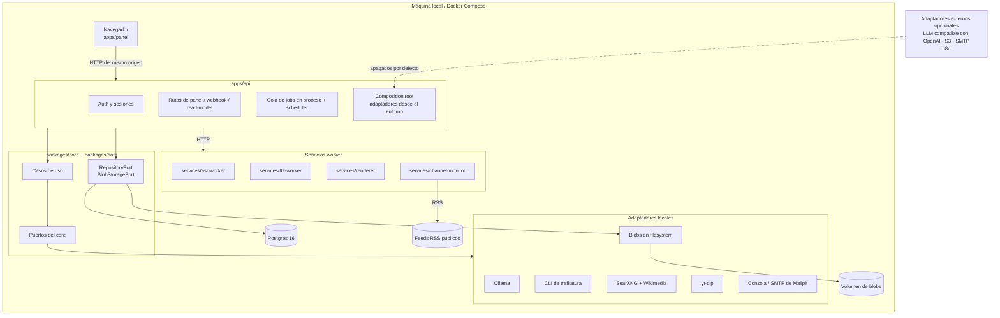
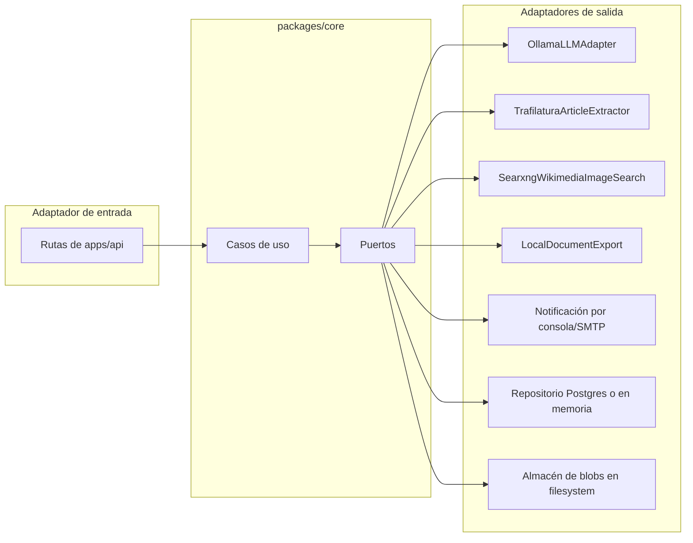

# Arquitectura

Este documento describe la estructura en tiempo de ejecución y de código de
Newsroom Video Automation. Es el mapa; los [ADR](adr/) registran por qué se tomaron
las decisiones principales, y el [modelo de datos](data-model.md) define el esquema
persistido.

## Objetivos

- **Local-first.** El stack por defecto corre en una sola máquina, sin claves de API
  ni cuentas en la nube.
- **Un solo backend.** El navegador habla solo con `apps/api`, nunca directamente con
  una base de datos ni con un servicio de terceros.
- **Puertos y adaptadores.** Las reglas de negocio no saben qué implementación de LLM,
  base de datos, almacenamiento o TTS hay detrás.
- **Runtime simple e inspeccionable.** Docker Compose, Postgres, módulos ES nativos y
  una única API en Node. El panel no tiene paso de build.
- **Demo reproducible.** El perfil por defecto, sin claves, puede recorrer una historia
  ficticia desde el descubrimiento hasta un video renderizado.

## Contexto del sistema

El panel lo sirve nginx, que redirige `/panel`, `/webhook`, `/tts`, `/subtitles`,
`/remotion`, `/radar`, `/monitor` y `/approval` a la API. Por eso el navegador tiene
un único origen, y la API sigue siendo el único límite de confianza para sesiones y
verificaciones CSRF.

## Límites de código

| Ruta | Responsabilidad | Depende de |
|---|---|---|
| `packages/contracts` | Helpers y esquemas de contratos compartidos | Nada local |
| `packages/core` | Casos de uso, reglas de dominio, cola de jobs, scheduler y puertos del core | `packages/contracts` |
| `packages/data` | `RepositoryPort`, `BlobStoragePort`, adaptadores en memoria y Postgres, runner de migraciones | `packages/contracts` |
| `packages/adapters` | Implementaciones locales-first de LLM, extracción, imágenes, RSS, descarga, exportación, notificaciones y n8n opcional | Puertos del core, helper de Python |
| `apps/api` | API HTTP, auth, sesiones, presencia, administración, read models y composition root | `packages/core`, `packages/data`, `packages/adapters` |
| `apps/panel` | UI editorial en módulos ES nativos | Solo la API HTTP |
| `services/asr-worker` | Servicio HTTP de faster-whisper, slot de GPU, respaldo de CUDA a CPU | Paquete compartido de workers |
| `services/tts-worker` | Selección de motor: Qwen TTS (GPU) y Piper (CPU) | Paquete compartido de workers |
| `services/renderer` | Composición de Remotion y servicio HTTP solo de render; el editor de aprobación lo llama a través del puerto del renderer | Contratos, assets de marca generados |
| `services/subtitles` | Alineación de subtítulos y renderizado con quemado | ASR worker por HTTP |
| `services/channel-monitor` | Sondeo de canales RSS públicos y recuperación de pendientes | Estado de runtime en Postgres/SQLite |
| `services/demo-worker` | Worker determinista sin claves para el perfil demo | Ninguna externa |
| `services/approval-editor` | Servicio HTTP del editor de aprobación, iniciado por Compose en el puerto 3042; llama al renderer por HTTP | `packages/contracts` |

Las dependencias apuntan hacia adentro: `apps/api` depende de `packages/core`; el core
nunca importa un adaptador, un cliente de base de datos ni un módulo del navegador.

## Núcleo hexagonal

El dominio es un conjunto de casos de uso que reciben sus colaboradores como puertos.
Las pruebas inyectan mocks definidos en el propio archivo; el composition root inyecta
los adaptadores de producción.

### Puertos

| Puerto | Paquete | Default local |
|---|---|---|
| `RepositoryPort` | `packages/data` | Postgres (en memoria para pruebas y demo) |
| `BlobStoragePort` | `packages/data` | Filesystem bajo `BLOB_ROOT` |
| `LLMPort` | `packages/core` | API nativa de Ollama |
| `NewsSourcePort` | `packages/core` | Feeds RSS públicos |
| `ArticleExtractorPort` | `packages/core` | CLI de Python de trafilatura |
| `ImageSearchPort` | `packages/core` | JSON de SearXNG y luego Wikimedia Commons |
| `ChannelFeedPort` | `packages/core` | RSS público de canales de YouTube |
| `MediaDownloadPort` | `packages/core` | `yt-dlp` local |
| `DocumentExportPort` | `packages/core` | `.docx` con python-docx + Markdown |
| `NotificationPort` | `packages/core` | Consola, o SMTP/Mailpit |
| `WorkflowTriggerPort` | `packages/core` | Desactivado; webhook de n8n opcional |
| `TTSPort` | `packages/core` | Worker HTTP de TTS (`TTS=worker`) o demo |
| `ASRPort` | `packages/core` | Worker HTTP de ASR (`ASR=worker`) o demo |
| `TranslationPort` | `packages/core` | `/api/subtitles/translate` de subtítulos o demo |
| `VideoRendererPort` | `packages/core` | Proyecto de renderer por HTTP (`RENDERER=worker`) o demo |
| `AuthPort` | `packages/core` | Repositorio de auth (`AUTH=local`), despliegue HTTP dividido o demo |

Los puertos de worker son clientes HTTP de `services/tts-worker`, `services/asr-worker`,
`services/subtitles` y `services/renderer`. Los adaptadores demo implementan el mismo
contrato, de modo que la ruta demo sin claves nunca abre un socket. Cada adaptador de
worker se selecciona con `TTS`, `ASR`, `TRANSLATION`, `RENDERER` y `AUTH`
(`worker`/`local`, `demo`, `none`). Los prefijos `/tts`, `/subtitles` y `/remotion` de
la API siguen siendo proxies de transporte transparentes para las pantallas de worker
que usa el navegador; cualquier llamada de dominio pasa por los puertos anteriores.

Cada puerto tiene un estado deshabilitado explícito (`LLM=none`, `IMAGE_SEARCH=none`,
`NOTIFY=none`, `WORKFLOW=disabled`, `*_ADAPTER=none`). Un adaptador ausente devuelve un
error tipado `adapter_unavailable` en lugar de romper las superficies de lectura y
guardado.

## Flujo de peticiones

### Descubrimiento y aprobación

1. `apps/api` inicia una ejecución de descubrimiento (programada o manual).
2. `DiscoverNews` pide a `NewsSourcePort` las filas de los feeds, filtra los elementos
   recientes y únicos, extrae el texto de los artículos y agrupa las historias
   relacionadas en clústeres.
3. Los clústeres y las filas en staging se persisten mediante `RepositoryPort`.
4. El panel lee `/panel/read-models/...`; aprobar un tema llama a
   `/webhook/approval/decision`.
5. `DecideApproval` registra la decisión y encola un job `draft-script`.
6. La cola en proceso toma el job, redacta el guion con `LLMPort`, lo valida contra la
   fuente y guarda un borrador versionado.

### Publicación y video

1. Publicar un borrador encola `publish-script`.
2. `PublishScript` prepara la pronunciación, exporta el documento, busca imágenes y
   crea la proyección del proyecto de video.
3. El panel renderiza el audio por la ruta de TTS, los subtítulos por el servicio de
   subtítulos y el video final por Remotion.
4. Los blobs se escriben a través de la API y se sirven desde `/panel/blobs/*`; el
   navegador nunca recibe una ruta del filesystem.

### Jobs y GPU

La `JobQueue` del core es serial por defecto, y el scheduler ejecuta tareas de
mantenimiento como la limpieza de sesiones vencidas. Los procesos worker con GPU
además toman un lock de archivo entre procesos (`NEWSROOM_GPU_LOCK_PATH`), de modo que
Whisper y TTS nunca se cargan juntos en una tarjeta de 8 GB. Los modelos los carga
cada worker bajo demanda.

El perfil `gpu` es un overlay real, no una etiqueta: los instaladores y `newsroom up`
añaden `infra/compose/compose.gpu.yaml`, que reserva el dispositivo para Ollama, ASR y
TTS, cambia el worker de ASR a CUDA/float16, construye el worker de TTS con el extra
de Qwen y lo apunta al checkpoint local de Qwen3-TTS 1.7B. Ollama descarga su modelo
inmediatamente después de cada petición en GPU (`OLLAMA_GPU_KEEP_ALIVE=0s`), porque un
LLM de 3B y el modelo de voz de 1.7B no caben juntos. Qwen clona la referencia sintética
de Piper que está versionada en `services/tts-worker/refs/`; el modo Piper en CPU la
ignora.

## Persistencia

- Esquema: `infra/db/migrations/*.sql`, aplicado por `packages/data/scripts/migrate.js`.
- Los nombres de los métodos del repositorio reflejan los RPC originales de Supabase; los
  RPC son métodos de código y no procedimientos almacenados, para mantener el SQL simple.
- Los payloads de descubrimiento en staging se guardan en tablas JSONB, de modo que las
  formas de datos de n8n sigan siendo recuperables.
- El adaptador en memoria implementa el mismo contrato que Postgres y lo usan las pruebas
  y el perfil demo sin claves.

Consulta [data-model.md](data-model.md) para tablas, claves y el mapeo de RPC.

## Seguridad

- Usuarios locales con hashes de contraseña bcrypt y roles `admin` / `editor` /
  `viewer`, aplicados en el servidor.
- Cookies de sesión HTTP-only y `SameSite=Lax`, con un almacén de sesiones del lado del
  servidor que guarda hashes y tiene expiración.
- Limitación de intentos de login y verificaciones CSRF/origin en las mutaciones.
- El panel se sirve con el mismo origen a través de nginx; la API no es un proxy abierto a
  CORS.
- Los secretos vienen de `.env` o del entorno del proceso. Los instaladores generan
  secretos locales aleatorios y nunca los versionan.
- La dirección de escucha por defecto es loopback; abrir el panel a una LAN es una
  decisión explícita y documentada.

## Perfiles de ejecución y modos

`NEWSROOM_MODE` selecciona el conjunto de adaptadores, y el gateway deriva de él los
destinos del proxy de medios. El **modo demo** (`demo`) envía TTS, subtítulos y render a
`demo-worker` y fuerza los adaptadores deterministas de LLM, extracción, traducción y
renderer. El **modo local** (`local`) envía los mismos prefijos a los workers reales y usa
los adaptadores de modelos locales. El panel lee `run_mode` de `/panel/bootstrap` y
marca en el encabezado una ejecución demo.

| Modo | Servicios | Uso |
|---|---|---|
| `demo` (default) | `api`, `panel`, `demo-worker`, `postgres`, `searxng`, `mailpit`, `seed` | Recorrido y evaluación sin modelos ni claves |
| `local` | `ollama`, `asr-worker`, `tts-worker`, `subtitles`, `renderer`, `channel-monitor` (CPU) | IA local real y medios reales |
| `local` + overlay `gpu` | los workers locales con acceso a GPU | IA local real en una tarjeta NVIDIA |
| `n8n` | `n8n` | Conector opcional de disparo y notificación |
| `tools` | `migrate`, `model-init` | Migraciones y descarga de modelos de una sola ejecución |
| `debug` | sobrescrituras de puertos de depuración para Postgres, SearXNG, Mailpit, Ollama y n8n | Solo inspección local |

Los instaladores seleccionan el overlay de GPU automáticamente cuando hay una GPU NVIDIA
y el container toolkit disponibles; en otro caso se quedan en CPU. Las descargas de
modelos ocurren solo en el paso explícito del instalador o de `newsroom models pull`; ningún
`command:` de contenedor descarga un modelo al iniciar. El contrato operativo está en
[docs/INSTALL.md](INSTALL.md).

## Conectores

Cada capacidad externa es un puerto con un default local y un adaptador opcional que se
selecciona desde `.env`:

| Conector | Puerto | Selección | Default |
|---|---|---|---|
| Ollama / endpoint compatible con OpenAI | `LLMPort` | `LLM=ollama\|openai` | Ollama |
| trafilatura | `ArticleExtractorPort` | `ARTICLE_EXTRACTOR=trafilatura` | trafilatura |
| SearXNG + Wikimedia | `ImageSearchPort` | `IMAGE_SEARCH=searxng` | SearXNG |
| yt-dlp | `MediaDownloadPort` | `MEDIA_DOWNLOAD=worker` | Worker de ASR |
| python-docx + Markdown | `DocumentExportPort` | `DOCUMENT_EXPORT=local` | CLI local |
| Consola / SMTP | `NotificationPort` | `NOTIFY=console\|smtp` | consola |
| Filesystem / S3 | `BlobStoragePort` | `STORAGE=fs\|s3` | filesystem |
| n8n | `WorkflowTriggerPort` | `WORKFLOW=disabled\|n8n` | desactivado |
| Repositorio local / split HTTP | `AuthPort` | `AUTH=local\|http` | repositorio local |

`GET /panel/connectors` devuelve el catálogo con estado `local`, `configured`,
`disabled` o `error`, y nunca devuelve credenciales. `POST /panel/connectors/:id/test`
ejecuta una sonda acotada. El contrato completo de variables de entorno y los ejemplos
están en [CONNECTORS.md](CONNECTORS.md).

## Privacidad e historial

El repositorio público conserva el historial real de commits de los repositorios
originales, así que la privacidad es una propiedad de cada commit alcanzable, no solo del
árbol actual:

- Los prefijos de perfil personal de Windows, el dominio personal y los hosts de preview
  se reemplazaron por `<WORKSPACE>` / `example.local` en cada ref (reescritura de historial
  autorizada; ver [ADR 0007](adr/0007-history-privacy.md)).
- Las claves de API, los JWT, las exportaciones de credenciales, las cookies, los archivos
  `.env`, los registros de auditoría de producción, los medios de marca del propietario y
  las superposiciones sin licencia no están en el historial.
- Las identidades de autor y committer de los commits usan direcciones noreply públicas;
  las fechas y los nombres de autor de los repositorios de origen se conservan.
- `gitleaks` se ejecuta sobre todas las refs, el blob más grande pesa menos de 5 MB, y una
  prueba de deny-list de contenido protege el árbol actual frente a personas, clubes y
  torneos reales. La compuerta final se vuelve a ejecutar desde un clon nuevo antes de
  publicar.
- Las capturas y los videos no pueden contener datos personales: se graban desde el
  viewport de la app con un `HOME` temporal, nunca desde un escritorio o un prompt de
  terminal.

## Estrategia de pruebas

- **Pruebas de contrato** para `RepositoryPort`: la misma suite corre contra los
  adaptadores en memoria y Postgres; los puertos de worker tienen una suite de contrato
  para sus adaptadores HTTP y demo.
- **Pruebas de casos de uso** en `packages/core` inyectan puertos mock y verifican el
  comportamiento del dominio sin I/O.
- **Pruebas HTTP** en `apps/api` ejercitan auth, sesiones, roles, rutas y el composition
  root con el adaptador en memoria.
- **Pruebas de servicio** por cada worker de Python y Node, con pruebas en vivo opt-in
  detrás de flags de entorno.
- **Pruebas estructurales** en `tools/tests` vigilan el stack de Compose, los assets de
  marca generados, la higiene del repositorio, la política de contenido y la documentación
  de portafolio.
- **QA visual**: `e2e/visual-qa.spec.js` revisa cada vista en ES/EN, en tamaños de
  escritorio y móvil, buscando desbordes, errores de consola, peticiones fallidas, texto de
  depuración, cadenas en otro idioma y violaciones graves de axe-core.
- **End-to-end**: `e2e/happy-path.spec.js` inicia sesión, aprueba un tema, publica un
  guion y renderiza audio, subtítulos y un MP4 final contra el stack demo sin claves.
  `e2e/local-mode.spec.js` ejecuta los modelos locales reales y verifica los medios con
  `ffprobe`.

## Decisiones

- [ADR 0001 — Núcleo hexagonal](adr/0001-hexagonal-core.md)
- [ADR 0002 — Valores por defecto local-first](adr/0002-local-first-defaults.md)
- [ADR 0003 — n8n opcional](adr/0003-optional-n8n.md)
- [ADR 0004 — UI vanilla](adr/0004-vanilla-ui.md)
- [ADR 0005 — Dos modos reales de ejecución](adr/0005-two-run-modes.md)
- [ADR 0006 — Conectores como puertos de primera clase](adr/0006-connectors.md)
- [ADR 0007 — Política de privacidad del historial](adr/0007-history-privacy.md)
- [ADR 0008 — Excepciones de tamaño de archivo por encima de 600 líneas](adr/0008-file-size-exceptions.md)
