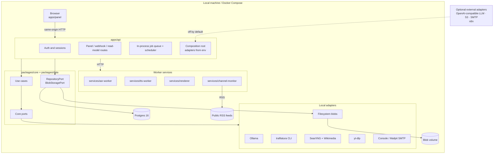
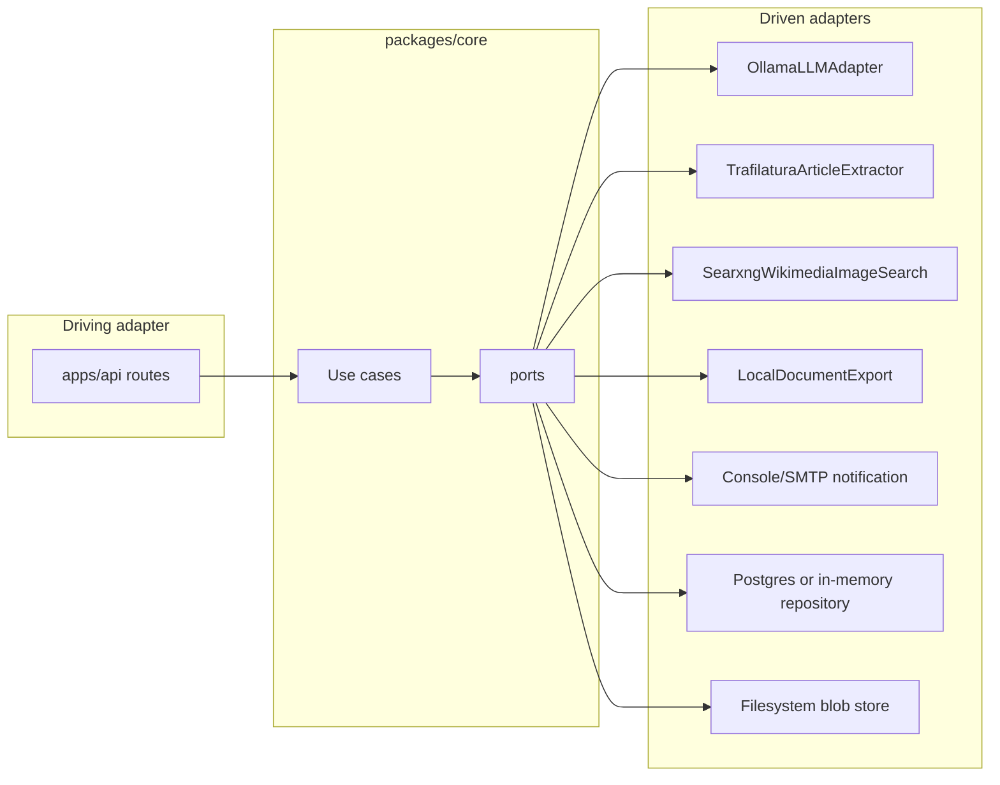

# Architecture

This document describes the runtime and code structure of Newsroom Video
Automation. It is the map; the [ADRs](adr/) record why the main choices were
made and the [data model](data-model.md) defines the persisted schema.

## Goals

- **Local-first.** The default stack runs on one machine with no API keys and
  no cloud accounts.
- **One backend.** The browser talks only to `apps/api`, never directly to a
  database or a third-party service.
- **Ports and adapters.** Business rules do not know which LLM, database,
  storage or TTS implementation is behind them.
- **Boring, inspectable runtime.** Docker Compose, Postgres, plain ES modules
  and a single Node API. No build step for the panel.
- **Reproducible demo.** The keyless default profile can walk one fictional
  story from discovery to a rendered video.

## System context

The panel is served by nginx, which proxies `/panel`, `/webhook`, `/tts`,
`/subtitles`, `/remotion`, `/radar`, `/monitor` and `/approval` to the API. The
browser therefore has one origin, and the API remains the only trusted boundary
for sessions and CSRF checks.

## Code boundaries

| Path | Responsibility | Depends on |
|---|---|---|
| `packages/contracts` | Shared contract helpers and schemas | Nothing local |
| `packages/core` | Use cases, domain rules, job queue, scheduler, core ports | `packages/contracts` |
| `packages/data` | `RepositoryPort`, `BlobStoragePort`, in-memory and Postgres adapters, migrations runner | `packages/contracts` |
| `packages/adapters` | Local-first implementations for LLM, extraction, images, RSS, download, export, notifications, optional n8n | Core ports, Python helper |
| `apps/api` | HTTP API, auth, sessions, presence, admin, read models, composition root | `packages/core`, `packages/data`, `packages/adapters` |
| `apps/panel` | Editorial UI in vanilla ES modules | The HTTP API only |
| `services/asr-worker` | faster-whisper HTTP service, GPU slot, CUDA→CPU fallback | Shared worker package |
| `services/tts-worker` | Qwen TTS (GPU) and Piper (CPU) engine selection | Shared worker package |
| `services/renderer` | Remotion composition and final render service | Contracts, generated brand assets |
| `services/subtitles` | Caption alignment and burn-in renderer | ASR worker via HTTP |
| `services/channel-monitor` | Public RSS channel polling and catch-up | Postgres/SQLite runtime state |
| `services/demo-worker` | Deterministic keyless worker for the demo profile | None external |
| `apps/panel/services/approval-editor` | Approval editor HTTP service started by Compose on port 3042 | `packages/contracts` |

Dependencies point inward: `apps/api` depends on `packages/core`; the core never
imports an adapter, a database client or a browser module.

## Hexagonal core

The domain is a set of use cases that receive their collaborators as ports.
Tests inject in-file mocks; the composition root injects production adapters.

### Ports

| Port | Package | Local default |
|---|---|---|
| `RepositoryPort` | `packages/data` | Postgres (in-memory for tests/demo) |
| `BlobStoragePort` | `packages/data` | Filesystem under `BLOB_ROOT` |
| `LLMPort` | `packages/core` | Ollama native API |
| `NewsSourcePort` | `packages/core` | Public RSS feeds |
| `ArticleExtractorPort` | `packages/core` | trafilatura Python CLI |
| `ImageSearchPort` | `packages/core` | SearXNG JSON, then Wikimedia Commons |
| `ChannelFeedPort` | `packages/core` | YouTube public channel RSS |
| `MediaDownloadPort` | `packages/core` | Local `yt-dlp` |
| `DocumentExportPort` | `packages/core` | python-docx `.docx` + Markdown |
| `NotificationPort` | `packages/core` | Console, or SMTP/Mailpit |
| `WorkflowTriggerPort` | `packages/core` | Disabled; optional n8n webhook |
| `TTSPort` | `packages/core` | TTS worker HTTP (`TTS=worker`) or demo |
| `ASRPort` | `packages/core` | ASR worker HTTP (`ASR=worker`) or demo |
| `TranslationPort` | `packages/core` | Subtitles `/api/subtitles/translate` or demo |
| `VideoRendererPort` | `packages/core` | Renderer project HTTP (`RENDERER=worker`) or demo |
| `AuthPort` | `packages/core` | Repository auth (`AUTH=local`), HTTP split deployment or demo |

The worker ports are HTTP clients for `services/tts-worker`,
`services/asr-worker`, `services/subtitles` and `services/renderer`. The demo
adapters implement the same contract so the keyless showcase path never opens a
socket. Every worker adapter is selectable with `TTS`, `ASR`, `TRANSLATION`,
`RENDERER` and `AUTH` (`worker`/`local`, `demo`, `none`). The API's `/tts`,
`/subtitles` and `/remotion` prefixes stay transparent transport proxies for
browser-driven worker screens; any domain call goes through the ports above.

Every port has an explicit disabled state (`LLM=none`, `IMAGE_SEARCH=none`,
`NOTIFY=none`, `WORKFLOW=disabled`, `*_ADAPTER=none`). A missing adapter returns
a typed `adapter_unavailable` error instead of crashing the read/save surfaces.

## Request flow

### Discovery and approval

1. `apps/api` starts a discovery run (scheduled or manual).
2. `DiscoverNews` asks `NewsSourcePort` for feed rows, filters recent/unique
   items, extracts article text and groups related stories into clusters.
3. Clusters and staged rows are persisted through `RepositoryPort`.
4. The panel reads `/panel/read-models/...`; approving a topic calls
   `/webhook/approval/decision`.
5. `DecideApproval` records the decision and enqueues a `draft-script` job.
6. The in-process queue claims the job, drafts the script with `LLMPort`,
   validates it against the source and stores a versioned draft.

### Publish and video

1. Publishing a draft enqueues `publish-script`.
2. `PublishScript` runs pronunciation prep, document export, image search and
   creates the video-project projection.
3. The panel renders audio through the TTS route, subtitles through the
   subtitles service and the final video through Remotion.
4. Blobs are written through the API and served from `/panel/blobs/*`; the
   browser never receives a filesystem path.

### Jobs and GPU

The core `JobQueue` is serial by default and the scheduler runs maintenance
tasks such as expired-session cleanup. GPU worker processes additionally take a
cross-process file lock (`NEWSROOM_GPU_LOCK_PATH`), so LLM, Whisper and TTS never
load together on an 8 GB card. Models are loaded on demand by their workers.

## Persistence

- Schema: `infra/db/migrations/*.sql`, applied by `packages/data/scripts/migrate.js`.
- Repository method names mirror the original Supabase RPCs; the RPCs are code
  methods rather than stored procedures, keeping SQL simple.
- Staged discovery payloads stay in JSONB staging tables so the n8n wire shapes
  remain recoverable.
- The in-memory adapter implements the same contract as Postgres and is used by
  tests and the keyless demo profile.

See [data-model.md](data-model.md) for tables, keys and the RPC mapping.

## Security

- Local users with bcrypt password hashes, `admin` / `editor` / `viewer` roles
  enforced server-side.
- HTTP-only, `SameSite=Lax` session cookies with a hashed server-side session
  store and expiry.
- Login rate limiting and CSRF/origin checks on mutations.
- The panel is served same-origin through nginx; the API is not a CORS-open
  proxy.
- Secrets come from `.env` or the process environment. The installers generate
  random local secrets and never commit them.
- The default bind address is loopback; opening the panel to a LAN is an
  explicit, documented choice.

## Runtime profiles

| Profile | Services | Use |
|---|---|---|
| default (CPU, no keys) | `api`, `panel`, `demo-worker`, `postgres`, `searxng`, `mailpit`, `seed`, `ollama` | Demo and evaluation |
| `gpu` | `asr-worker`, `tts-worker`, `channel-monitor` | Real local ASR/TTS and monitoring |
| `n8n` | `n8n` | Optional external trigger adapter |
| `tools` | `migrate`, `model-init` | One-shot migrations and model download |

The installers select the `gpu` profile automatically when an NVIDIA GPU and
the container toolkit are available, and otherwise stay on CPU. See
[docs/INSTALL.md](INSTALL.md) for the operational contract.

## Testing strategy

- **Contract tests** for `RepositoryPort` run the same suite against in-memory
  and Postgres adapters.
- **Use-case tests** in `packages/core` inject mock ports and assert domain
  behaviour without I/O.
- **HTTP tests** in `apps/api` exercise auth, sessions, routes and the
  composition root with the in-memory adapter.
- **Service tests** per Python/Node worker, with opt-in live tests behind
  environment flags.
- **Structural tests** in `tools/tests` guard the Compose stack, the generated
  brand assets, repository hygiene and the portfolio documentation.
- **End-to-end** `e2e/happy-path.spec.js` logs in, approves a topic, publishes a
  script, renders audio, subtitles and a final MP4 against the keyless stack.

## Decisions

- [ADR 0001 — Hexagonal core](adr/0001-hexagonal-core.md)
- [ADR 0002 — Local-first defaults](adr/0002-local-first-defaults.md)
- [ADR 0003 — Optional n8n](adr/0003-optional-n8n.md)
- [ADR 0004 — Vanilla UI](adr/0004-vanilla-ui.md)
