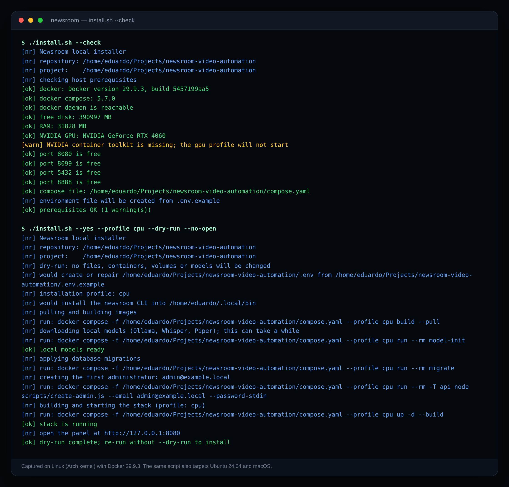
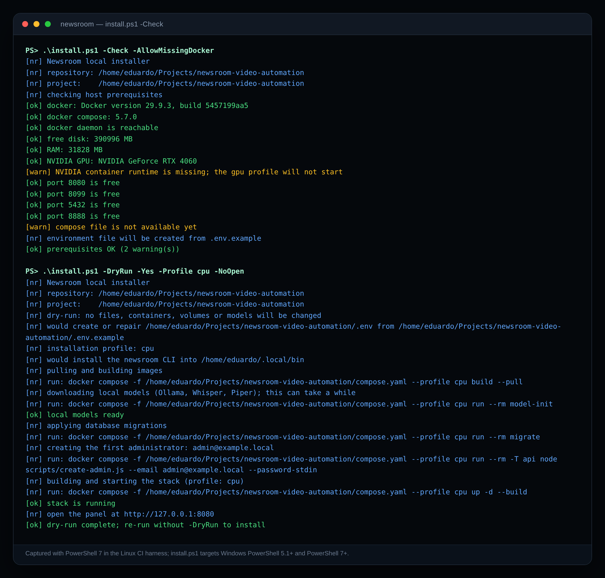

# Instalar Newsroom localmente

Newsroom corre por completo en tu máquina. La instalación por defecto **no usa claves de
API ni cuentas en la nube**: Postgres, SearXNG, Mailpit, la API, el panel y los workers
corren como contenedores locales, y los modelos de LLM, voz y transcripción se descargan a
volúmenes locales.

El instalador soporta Windows 10/11 (PowerShell 5.1+ y PowerShell 7+) y Linux (probado en
Ubuntu 24.04 y Arch). macOS funciona con el instalador de bash como mejor esfuerzo.

**Qué se ejecutó realmente:** las suites del instalador y de la CLI de Linux corren en
`ubuntu-latest` en CI y en la máquina Arch/CachyOS del autor, incluida una instalación demo
desde un clon nuevo y un render real de modo local en CPU. El instalador de Windows está
cubierto por el job `windows-latest` de CI (parser, verificación de prerrequisitos y
dry-run) y por pruebas de comportamiento de PowerShell 7 en Linux; no se ha ejecutado en un
escritorio físico con Windows 10/11. La ruta GPU se verificó de verdad en una RTX 4060 de
8 GB con `nvidia-container-toolkit`: la imagen de humo CUDA funciona, el E2E de modo local
pasó con Ollama en GPU, faster-whisper y Qwen3-TTS reales, y los tiempos medidos están en
[Ejecución GPU verificada](#ejecución-gpu-verificada).





## Requisitos

| Requisito | Linux | Windows |
|---|---|---|
| Docker | Docker Engine + plugin Compose v2 | Docker Desktop con backend WSL2 (contenedores Linux) |
| Disco | 10 GB libres (más para los modelos GPU) | 10 GB libres (más para los modelos GPU) |
| RAM | 8 GB mínimo | 8 GB mínimo |
| GPU (opcional) | Driver NVIDIA + `nvidia-container-toolkit` | Driver NVIDIA para WSL2 (Docker Desktop lo detecta) |
| Shell | bash 4+ | PowerShell 5.1 o 7 |

El instalador verifica todos estos puntos antes de tocar el host. `--check` / `-Check`
ejecuta solo las verificaciones.

## Inicio rápido (Linux)

```bash
git clone https://github.com/Eduardo12Pacheco/automatizacion-video-noticias.git
cd automatizacion-video-noticias
./install.sh
```

El instalador:

1. muestra un banner corto y verifica Docker, el daemon, Compose v2, disco, RAM y puertos;
2. pregunta el modo de ejecución (`demo` por defecto, o `local`) y, cuando hay una GPU
   NVIDIA disponible, si se usa el perfil `gpu`;
3. crea `.env` a partir de `.env.example` con secretos aleatorios nuevos, modo `0600`;
4. instala la CLI `newsroom` en `~/.local/bin` (se puede cambiar con `--bin-dir`);
5. construye las imágenes y, en modo `local`, descarga los modelos;
6. aplica las migraciones de base de datos;
7. crea el primer administrador e imprime la contraseña generada una sola vez;
8. levanta el stack, abre <http://127.0.0.1:8080> e imprime un resumen con la URL del panel,
   el administrador, la contraseña y los comandos de ciclo de vida.

Cada fase imprime una línea de progreso `[n/7]`. Las preguntas se omiten con `--yes`, en CI
y cuando está presente el flag correspondiente (`--mode`, `--gpu`, `--no-gpu`).

## Inicio rápido (Windows)

Abre PowerShell en el directorio clonado:

```powershell
Set-ExecutionPolicy -Scope Process Bypass
.\install.ps1
```

El comportamiento es idéntico al del instalador de bash. La CLI se instala en
`%LOCALAPPDATA%\Newsroom\bin` como `newsroom.cmd` / `newsroom.ps1`; añade ese directorio al
`PATH` para ejecutar `newsroom` desde cualquier shell.

Si PowerShell bloquea el script, ejecútalo de forma explícita:

```powershell
powershell -NoProfile -ExecutionPolicy Bypass -File .\install.ps1
```

## Modos de ejecución

`NEWSROOM_MODE` selecciona qué pipeline real se ejecuta. El instalador usa `demo` por
defecto; pasa `--mode local` (bash) o `-Mode local` (PowerShell) para el stack de IA local
real. El panel marca la ejecución demo en su encabezado.

| Modo | Qué corre | Descargas |
|---|---|---|
| `demo` (default) | Adaptadores deterministas detrás de la API; el panel muestra **Modo demo / Demo mode** | Ninguna |
| `local` | Redacción de guiones con Ollama real, extracción con trafilatura, voz Piper, subtítulos con faster-whisper y un MP4 de 720p con Remotion en CPU (GPU opcional) | Ollama `qwen2.5:3b-instruct` (~2 GB), Whisper `small` (~0.5 GB), Piper `es_ES-davefx-medium` (~60 MB) |

Las descargas de modelos solo ocurren en el instalador o con `newsroom models pull`; el
contenedor de Ollama nunca descarga un modelo al iniciar. El modo demo omite por completo el
paso de modelos.

## Perfiles

| Perfil | Se selecciona cuando | Contiene |
|---|---|---|
| default/`cpu` | No hay GPU NVIDIA, o `--profile cpu` / `-Profile cpu` | API, panel, `demo-worker`, Postgres, SearXNG, Mailpit y el seed determinista; sin claves de API |
| `local` | `--mode local` (se activa con `COMPOSE_PROFILES=local` en `.env`) | Los workers reales en CPU: `ollama`, `asr-worker`, `tts-worker`, `subtitles`, `renderer`, `channel-monitor` |
| `gpu` | `nvidia-smi` detecta una GPU y el runtime de contenedores está listo | El stack local con acceso a GPU; el instalador y `newsroom up` añaden `infra/compose/compose.gpu.yaml` automáticamente para que Ollama, ASR y TTS reserven el dispositivo y TTS use Qwen en lugar de Piper |
| `n8n` | `--profile n8n` explícito | El contenedor opcional de n8n para `WORKFLOW=n8n` |
| `tools` | Nunca lo inicia `up` | Servicios de una sola ejecución `migrate` y `model-init`, invocados con `docker compose run --rm` |
| `auto` | Default | Elige `gpu` o `cpu` según lo descrito arriba |

El worker demo es deliberadamente determinista: sirve los contratos de TTS, subtítulos y
render con assets locales pequeños, para que la prueba de navegador corra sin GPU ni
descarga de modelos. Al seleccionar el modo `local`, cada ruta de medios pasa a los workers
reales (Piper en CPU, faster-whisper `small` int8, Remotion 720p); el perfil `gpu` solo añade
acceso a GPU para quien la tenga.

### Datos de prueba y la historia demo

El servicio `seed`, sin perfil, se ejecuta cuando Postgres está sano y es idempotente. Crea
dos usuarios ficticios (`editor@example.local` y `viewer@example.local`, con la contraseña
generada en `NEWSROOM_DEMO_PASSWORD`), un tema de aprobación pendiente y una historia completa
con un borrador y un proyecto de video. La cuenta de administrador que crea el instalador es
distinta, y su contraseña se imprime una sola vez; usa esa cuenta para iniciar sesión de
forma interactiva, salvo que `NEWSROOM_DEMO_PASSWORD` se haya definido explícitamente antes
de instalar. El entorno E2E define ese valor para que la prueba pueda iniciar sesión como
editor.

Un `--profile gpu` explícito nunca se degrada en silencio. Si falta el runtime de contenedores,
el instalador avisa y `auto` cae a `cpu`. Instala `nvidia-container-toolkit` (Linux) o
actualiza Docker Desktop (Windows) para usar la GPU. La reserva del dispositivo GPU vive en
`infra/compose/compose.gpu.yaml`, que cada llamada de instalador y de la CLI a Compose añade
cuando el perfil `gpu` está activo; un overlay ausente es un error fatal y no una caída
silenciosa a CPU.

`newsroom doctor` informa de la GPU en dos pasos: la tarjeta y el runtime detectados, y una
prueba real de paso a través del contenedor (`docker run --rm --gpus all
nvidia/cuda:12.4.1-base-ubuntu22.04 nvidia-smi -L`) cuando se selecciona el perfil `gpu`.
Puedes sustituir la imagen de la prueba con `NEWSROOM_GPU_PROBE_IMAGE` en un host sin acceso
a internet.

La instalación GPU descarga el checkpoint de Qwen3-TTS 1.7B (~4.5 GB) en el mismo paso
`model-init` que los modelos de Piper y Whisper. `services/tts-worker/refs/` incluye una voz
de referencia sintética de Piper de 6 segundos, para que el motor Qwen clone una voz sin
necesidad de una grabación. Ollama descarga su modelo inmediatamente en GPU
(`OLLAMA_GPU_KEEP_ALIVE=0s`, sustituible), porque la voz Qwen de 1.7B y un LLM de 3B no
pueden permanecer residentes juntos en 8 GB.

Un solo job de GPU corre a la vez mediante `NEWSROOM_GPU_LOCK_PATH`; la cola de la API
mantiene serial el slot de GPU.

### Ejecución GPU verificada

La ruta `gpu` se verificó en una RTX 4060 de 8 GB (driver 620.70, `nvidia-container-toolkit`)
con la imagen de humo CUDA de la verificación `doctor`. El mismo `e2e/local-mode.spec.js` que
corre en CPU pasó con medios reales de GPU:

| Etapa | GPU | Referencia CPU |
|---|---|---|
| Borrador del guion con Ollama | 5.1 s | 22.3 s |
| Voz Piper/Qwen | 90.1 s (Qwen3-TTS 1.7B) | 17.8 s (Piper) |
| Subtítulos con faster-whisper | 44.9 s | 46.5 s |
| Render de Remotion | 188.7 s (CPU) | 177.3 s (CPU) |
| Spec completa | 6.1 min | 5.2 min |

Ambas columnas son el mismo `e2e/local-mode.spec.js` ejecutado en una misma máquina (laptop
con RTX 4060 de 8 GB, 12 núcleos, 31 GB de RAM): CPU es la referencia, y `--gpu` mantiene el
render de Remotion en CPU. Los números cubren la spec completa, desde el descubrimiento
hasta el MP4 final, no un micro-benchmark.

El uso máximo de la tarjeta completa fue de 6646 MB de 8188 MB (incluido el escritorio), por
lo que la variante de voz de 1.7B es la opción que cabe en 8 GB. El modo GPU trata, por tanto,
de calidad de voz y velocidad del LLM, no de una ejecución de punta a punta más rápida; el
render sigue en CPU. El informe de Qwen registra `engine=QwenCloneEngine, device=cuda:0`, y
el log del servidor de Ollama registra buffers `CUDA0` y respuestas de `POST /api/chat`.

## Uso no interactivo

```bash
./install.sh --yes --mode demo --no-gpu
```

```powershell
.\install.ps1 -Yes -Mode demo -NoGpu
```

Con `--yes` / `-Yes`, la contraseña del primer administrador se genera e imprime exactamente
una vez; no se escribe en `.env` ni en el archivo de estado. Para la automatización que
necesite controlar la contraseña, pásala por el entorno (nunca por argv):

```bash
NEWSROOM_ADMIN_PASSWORD='elige-una-contraseña-larga' ./install.sh --yes --profile cpu
```

Otras opciones:

```text
--mode / -Mode                 demo (default) o local
--profile / -Profile           auto (default), cpu o gpu
--gpu / -Gpu                   usa el perfil gpu
--no-gpu / -NoGpu              usa cpu aunque haya una GPU presente
--port / -Port                 puerto publicado del panel (default 8080); las listas
                               de orígenes localhost se ajustan a él
--no-models / -NoModels        omite la descarga de modelos
--no-start / -NoStart          prepara la instalación sin iniciarla
--no-open / -NoOpen            no abre el panel
--admin-email / -AdminEmail    correo del primer administrador
--project-dir / -ProjectDir    directorio que contiene .env y compose.yaml
--compose-file / -ComposeFile  sustituye el archivo de Compose
--allow-missing-docker / -AllowMissingDocker  solo para CI y autoverificación
--version / -Version           versión del instalador
```

`--dry-run` / `-DryRun` imprime cada acción sin crear archivos ni iniciar contenedores.

## La CLI `newsroom`

| Comando | Comportamiento |
|---|---|
| `newsroom up` | construye e inicia el stack |
| `newsroom down` | detiene el stack, conserva volúmenes y datos |
| `newsroom status` | `docker compose ps` |
| `newsroom logs [servicio]` | sigue los logs (`--no-follow` imprime y termina) |
| `newsroom update` | rechaza un checkout con cambios, ejecuta `git pull --ff-only`, descarga/construye imágenes, aplica migraciones y reinicia |
| `newsroom mode demo\|local` | escribe el modo de ejecución, descarga los modelos al cambiar a `local` y reinicia el stack |
| `newsroom doctor` | Docker, daemon, Compose, GPU, disco, RAM, puertos, modelos, administrador y estado de la instalación |
| `newsroom models [pull]` | descarga los modelos locales si faltan (`pull` fuerza la actualización) |
| `newsroom test` | ejecuta las mismas suites que CI (`tools/run-all-tests.mjs`) |
| `newsroom version` | versión de la CLI |
| `newsroom help` | uso |

Opciones globales: `--project-dir <ruta>`, `--profile cpu|gpu`, `--dry-run`.

`doctor` termina con código distinto de cero cuando falla una verificación bloqueante, así que
puede usarse en scripts:

```bash
newsroom doctor || echo "corrige las verificaciones fallidas de arriba"
```

El umbral de disco depende del modo: demo necesita 2 GB, local necesita 10 GB. Los puertos
que ya publica este stack se informan como propios y no como conflicto. En sistemas de
archivos donde la sonda de espacio libre o de puertos en escucha da un resultado erróneo,
`NEWSROOM_DISK_MB_OVERRIDE` y `NEWSROOM_LISTENING_PORTS_OVERRIDE` (separado por comas) permiten
que el operador indique los valores; las pruebas del instalador usan los mismos overrides para
no depender nunca del host.

## Primer administrador

El primer administrador se crea a través del contenedor de la API, así que la contraseña se
hashea con bcrypt antes de llegar a la base de datos. **No existe una contraseña por defecto.**

- Instalación interactiva: el instalador pide el correo y una contraseña (mínimo 8 caracteres).
- `--yes` / `-Yes`: se genera una contraseña aleatoria y se imprime una vez.
- Gestión de administradores después: la pantalla **Usuarios** (rol admin) o los endpoints
  `/panel/admin/users` de la API. Los roles son `admin`, `editor` y `viewer`, aplicados en el
  servidor.

Si pierdes la contraseña, restablécela desde el checkout:

```bash
printf '%s' 'nueva-contraseña-larga' | docker compose run --rm -T api \
  node scripts/create-admin.js --email admin@example.local --password-stdin --reset-password
```

## Actualizar y desinstalar

```bash
newsroom update
```

Volver a ejecutar `install.sh` / `install.ps1` también es seguro: los secretos existentes se
conservan, las descargas y las migraciones se omiten cuando el estado indica que ya terminaron,
y el stack se reconstruye y reinicia. La contraseña del administrador no se restablece.

Detener y eliminar los contenedores pero conservar los datos:

```bash
./install.sh --uninstall
```

Eliminar contenedores **y** volúmenes, modelos, imágenes y `.env`. Las purgas destructivas
siempre piden escribir `delete`, incluso con `--yes`; usa `--force-purge` / `-ForcePurge` solo
en automatización desatendida:

```bash
./install.sh --uninstall --purge
./install.sh --uninstall --purge --force-purge   # sin confirmación
```

```powershell
.\install.ps1 -Uninstall -Purge
.\install.ps1 -Uninstall -Purge -ForcePurge       # sin confirmación
```

## Abrir el panel a la LAN

Solo se publican los puertos del panel y de la API, y `NEWSROOM_BIND` controla su interfaz del
host (`127.0.0.1` por defecto). `.env.example` mantiene `API_GATEWAY_HOST=0.0.0.0` para que la
API escuche en la red de Compose, donde la usa el proxy nginx del panel; no se publica
directamente en el host. Para que otras personas de tu LAN usen el panel:

1. Define `NEWSROOM_BIND=0.0.0.0` (o tu dirección LAN) en `.env`.
2. Añade el origen LAN a `API_GATEWAY_ALLOWED_ORIGINS` y a
   `API_GATEWAY_TRUSTED_MUTATION_ORIGINS`.
3. Permite el puerto del panel en el firewall del host.
4. Abre `http://<tu-ip-lan>:8080`.

> **HTTP sin cifrar en una LAN solo es aceptable en redes de confianza.** La cookie de sesión
> es HTTP-only y SameSite=Lax, y solo se vuelve `Secure` automáticamente cuando la API ve HTTPS
> (directamente, o a través del proxy de confianza del panel con `X-Forwarded-Proto`). Quien
> pueda observar el tráfico de la LAN puede leer el token de sesión sobre HTTP sin cifrar.

### HTTPS opcional (recomendado en redes compartidas)

Mantén el stack vinculado a loopback y pon delante del panel un terminador TLS que controles.
Por ejemplo, con Caddy en el mismo host:

```caddyfile
newsroom.example.lan {
    reverse_proxy 127.0.0.1:8080
}
```

Caddy obtiene o usa un certificado local y envía el HTTPS al panel. El panel reenvía el esquema
HTTPS a la API, que marca la cookie de sesión como `Secure`; vuelve a iniciar sesión después de
pasar de HTTP a HTTPS para regenerar la sesión del navegador. Un terminador nginx funciona igual
mientras envíe `X-Forwarded-Proto: https`. No aceptes esa cabecera de clientes no confiables:
coloca el panel solo detrás de un proxy inverso que tú operes.

Postgres, Ollama, SearXNG, Mailpit y n8n no se publican. Para depurar, añade el override
opcional:

```bash
docker compose -f compose.yaml -f infra/compose/compose.debug.yaml up
```

Las sesiones son cookies HTTP-only y SameSite=Lax, con almacén en el servidor y expiración.
Los intentos de login tienen límite de frecuencia. No expongas el stack a internet pública.

## Ejecutar Compose sin el instalador

`docker compose up` por sí solo falla por diseño en un clon nuevo: el stack necesita secretos
generados y una red de proxy para el panel, y Compose se detiene con el mensaje
`run ./install.sh first ...` cuando falta `.env`. Ejecuta el instalador una vez
(`./install.sh` / `.\install.ps1`), o inicia Compose con un archivo de entorno completo:

```bash
docker compose --env-file ruta/a/completo.env up -d
```

`compose.yaml` interpola las variables requeridas, y los mensajes `:?` del archivo incluyen la
misma pista. Es intencional: caer en silencio a valores por defecto débiles entregaría una
instalación insegura.

## Configuración

Todo se lee desde `.env`, generado a partir de [`.env.example`](../.env.example).
Valores útiles:

| Variable | Default | Significado |
|---|---|---|
| `NEWSROOM_PROFILE` | `cpu` | Lo escribe el instalador; `cpu` o `gpu` |
| `PANEL_PORT` / `API_GATEWAY_PORT` | `8080` / `8099` | Puertos del host |
| `NEWSROOM_BIND` | `127.0.0.1` | Interfaz del host para los puertos publicados del panel y la API |
| `NEWSROOM_PANEL_SUBNET` / `NEWSROOM_PANEL_IP` | `/24` libre elegido por el instalador y `.10` | Red dedicada del proxy del panel y dirección fija del panel |
| `TRUSTED_PROXY_CIDRS` | `<NEWSROOM_PANEL_IP>/32` | Dirección del contenedor del panel autorizada a definir `X-Forwarded-For` |
| `DATABASE_URL` | Postgres local | Cadena de conexión del repositorio |
| `LLM` | `ollama` | Adaptador de modelo local; `openai` es opcional y está desactivado por defecto |
| `OLLAMA_MODEL` | `qwen2.5:3b-instruct` | Modelo local con soporte para español |
| `ARTICLE_EXTRACTOR` | `trafilatura` | Extracción local de artículos |
| `IMAGE_SEARCH` | `searxng` | Búsqueda local de imágenes, con respaldo en Wikimedia |
| `NOTIFY` | `console` | Notificaciones locales; `smtp` usa Mailpit/Gmail |
| `WORKFLOW` | `disabled` | Perfil opcional de orquestación con n8n |
| `TTS_WORKER_ENGINE` | `piper` | Piper en CPU; el overlay `gpu` selecciona Qwen |
| `WHISPER_MODEL` | `small` | Modelo de faster-whisper |

Los secretos que genera el instalador tienen 48 caracteres hexadecimales y son únicos por
clave. No versiones `.env`. No pongas claves de API reales en `.env.example`.

## Solución de problemas

| Síntoma | Solución |
|---|---|
| `docker is not installed or not in PATH` | Instala Docker Engine/Desktop y vuelve a abrir la shell. En Windows usa el backend WSL2. |
| `docker daemon is not reachable` | Inicia Docker Desktop o `sudo systemctl start docker`. |
| `compose file not found` | El stack de Compose no está en este checkout; consulta [el contrato de Compose](../infra/install/COMPOSE_CONTRACT.md). |
| `docker compose ... run --rm model-init` falla | Libera espacio en disco y vuelve a ejecutar; el paso es idempotente. |
| Puerto en uso | Cambia `PANEL_PORT`/`API_GATEWAY_PORT`/etc. en `.env` y vuelve a ejecutar `newsroom up`. |
| La GPU no se usa | Ejecuta `nvidia-smi`, instala `nvidia-container-toolkit` y luego `./install.sh --profile gpu`. |
| El panel no alcanza la API | Revisa `API_GATEWAY_ALLOWED_ORIGINS` y el origen de la API en el panel. |
| El login falla tras una instalación nueva | La contraseña generada se imprimió una sola vez. Restablécela con el comando de [Primer administrador](#primer-administrador). |

Recoge diagnósticos con:

```bash
newsroom doctor
docker compose ps
docker compose logs --tail=200 api
```

## Verificación en este repositorio

La lógica del instalador está cubierta por `infra/install/tests` a través de los comandos
públicos, usando un stand-in determinista de `docker`:

```bash
bash infra/install/tests/run.sh
```

La suite también ejecuta los scripts de Windows con PowerShell 7 cuando `pwsh` está disponible.
El workflow de CI `.github/workflows/installers.yml` ejecuta las verificaciones en
`ubuntu-latest` y `windows-latest`; el job de Windows mantiene Docker como opcional porque el
runner hospedado no provee contenedores Linux.

## Verificación end-to-end

El stack por defecto incluye el happy path de Playwright:

```bash
export NEWSROOM_ENV_FILE=e2e/.env.example
export E2E_COMPOSE_ENV=e2e/.env.example
docker compose --env-file "$E2E_COMPOSE_ENV" up -d --build postgres searxng mailpit demo-worker api panel
docker compose --env-file "$E2E_COMPOSE_ENV" run --rm seed
pnpm install --frozen-lockfile
pnpm exec playwright install chromium
E2E_ALLOW_RESET=1 pnpm exec playwright test e2e/happy-path.spec.js e2e/panel-flows.spec.js
```

No copies `e2e/.env.example` sobre un `.env` instalado: reemplazaría los secretos generados por
el instalador. Pasa el archivo E2E con `--env-file`, como se muestra. `E2E_ALLOW_RESET=1`
autoriza el reinicio destructivo de los flujos del panel y solo debe usarse contra un stack
demo desechable creado para la suite E2E.

Usa `docker compose down -v` entre ejecuciones. La prueba inicia sesión por la UI, aprueba un
tema, espera el guion redactado, lo publica y verifica los artefactos de voz, subtítulos y
render final a través del proxy del panel. Consulta [e2e/README.md](../e2e/README.md).

El contrato de Compose está documentado en
[COMPOSE_CONTRACT.md](../infra/install/COMPOSE_CONTRACT.md).
