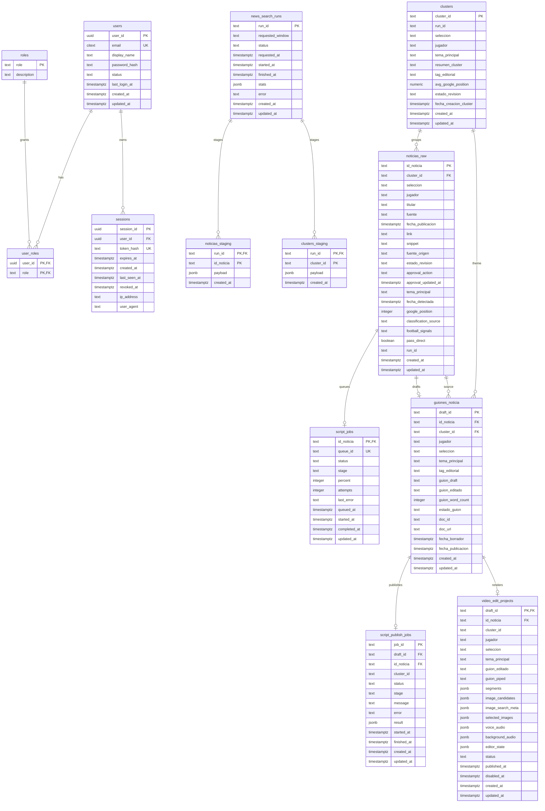

# Modelo de datos

Este documento es la fuente de verdad del esquema local de Postgres. Se reconstruyó por
ingeniería inversa a partir de la única evidencia que sobrevive:

- `examples/legacy-n8n/workflows.json`: cuerpos de los nodos HTTP, payloads de upsert y
  nombres de campos y valores de estado de los Code nodes.
- Los shapers de read model del panel bajo `apps/panel/js/modules/features/`.
- El inventario de tablas y RPC capturado en la sección de contexto del documento de
  feature.
- Ya no existe ningún volcado, proyecto ni credencial de Supabase, así que el DDL original
  no puede recuperarse byte a byte. Los nombres y tipos de abajo son la reconstrucción
  elegida; los nombres de cable de n8n y del panel se conservan siempre que la evidencia los
  da (`id_noticia`, `draft_id`, `estado_revision`, ...).

Las migraciones viven en `infra/db/migrations/` y las aplica
`packages/data/scripts/migrate.js`. El SQL es deliberadamente simple: solo tablas, restricciones
e índices. Los antiguos RPC de Supabase se implementan como métodos del repositorio
(`packages/data/src/ports/repository-port.js`) y se expondrán como casos de uso del core, no
como procedimientos almacenados.

## Diagrama ER

## Tablas

### Usuarios, roles y sesiones

| Tabla | Propósito |
|---|---|
| `roles` | Semillas `admin`, `editor`, `viewer`. La autorización del lado del servidor lee estas filas. |
| `users` | Cuentas locales. `password_hash` guarda un hash Argon2id/bcrypt producido por la API (nunca una contraseña en texto plano). `status` es `active` o `disabled`. |
| `user_roles` | Relación muchos a muchos de roles; la API, y no un trigger, exige al menos un rol por usuario. |
| `sessions` | Almacén de sesiones del lado del servidor. La cookie del navegador lleva un token aleatorio; en `token_hash` solo se guarda su hash SHA-256. Las filas vencidas o revocadas las elimina la limpieza. |

`email` usa `citext` para que el login no distinga mayúsculas. Los UUID los genera
`gen_random_uuid()` (`pgcrypto`), así que no se necesitan identificadores enviados por el cliente.

### Descubrimiento y aprobación

`news_search_runs` es la máquina de estados de una ejecución de "Approval Search Refresh"
(`queued` → `discovery_running` → `discovery_succeeded` → `cluster_running` →
`cluster_succeeded` → `promoting` → `promoted`, con `failed` como estado terminal). Las
funciones edge de n8n aceptaban `create_run`, `get_run`, `update_run`, `reset_staging` y
`promote_run`; hoy esas acciones son métodos del repositorio.

Los resultados de descubrimiento en staging se guardan como payloads JSON en `noticias_staging`
y `clusters_staging`. Las funciones edge originales trataban los datos en staging como un
snapshot opaco hasta `promote_run`; mantener JSONB aquí evita duplicar la lista grande de
columnas de `noticias_raw`/`clusters` y mantiene el SQL simple.

`noticias_raw` es el universo vivo de aprobación. `estado_revision` es
`pendiente`/`aprobado`/`rechazado`/`publicado`; `approval_action` registra la última decisión
(`approve`/`reject`). `google_position` y `classification_source` provienen del workflow de
descubrimiento (`heuristic`/`ai`).

`clusters` agrupa dos o más noticias en un tema editorial. El workflow de descubrimiento calcula
`avg_google_position`; el panel lee `cantidad_fuentes`/`sources` de `get_pending_approval_clusters`
y `get_approval_topic_detail`, que el repositorio arma uniendo `noticias_raw`.

### Cola de guiones y borradores

`script_jobs` es el modelo de escritura detrás de `get_script_queue_monitor`,
`claim_script_job`, `update_script_job_progress`, `complete_script_job` y `fail_script_job`.
`queue_id` es un id de visualización estable (por defecto, `id_noticia`). Un job reclamado sale
de la cola pendiente al pasar `status` a `running`; `complete_script_job` además hace upsert del
borrador.

`guiones_noticia` guarda los guiones generados o editados. `estado_guion` es
`borrador`/`publicado`/`descartado`. `get_pending_script_drafts` devuelve los borradores que no
están publicados ni descartados. `save_script_draft` actualiza `guion_editado`;
`dismiss_script_from_panel` pone `estado_guion='descartado'`. `get_publishable_script_draft`
devuelve el borrador junto con el snapshot de la fuente que necesita el workflow de publicación.
`finalize_script_publish` pone `estado_guion='publicado'` y completa los campos de documento
compatibles con Google (`doc_id`, `doc_url`, `fecha_publicacion`).

### Jobs de publicación

`script_publish_jobs` es el registro de progreso que usa el endpoint `Webhook Publish Status`
del panel. Los estados que se ven en n8n son `queued`, `running`, `completed` y `failed`; las
etapas son `queued`, `saving_script`, `creating_doc`, `rewriting_pronunciation`,
`searching_images`, `caching_images`, `uploading_txt`, `finalizing`, `completed` y `failed`.
Las actualizaciones `onlyActive` (el filtro PATCH de n8n) exigen que `status` no esté en
`(completed, failed)` y que `finished_at` sea nulo.

### Proyectos de video

`video_edit_projects` es el modelo de lectura/escritura detrás de los seis RPC de proyectos de
video. Las columnas JSONB conservan las formas exactas de cable:

- `segments`: `[{id, order, text, phrase, selected_image_id, duration_seconds, notes, source}]`
- `image_candidates`: objetos candidatos en caché que el panel puede abrir
- `image_search_meta`: metadatos de proveedor, consulta, ventana y estado
- `selected_images`: lista ordenada de ids o URLs candidatos
- `voice_audio` / `background_audio`: `{kind, bucket, storage_path, public_url, name, size, mime_type, ...}`
- `editor_state`: la instantánea del editor del panel (`phase`, `motion`, `media`, ...)

`disable_video_edit_project` es un borrado lógico: pone `disabled_at` y `status='disabled'`,
conservando el proyecto y sus medios para auditoría. Por defecto, las lecturas excluyen los
proyectos deshabilitados.

## Mapeo de RPC a métodos del repositorio

| RPC original de Supabase | Método del repositorio |
|---|---|
| `claim_script_job` | `claimScriptJob({ idNoticia })` |
| `update_script_job_progress` | `updateScriptJobProgress({ idNoticia, status, stage, percent, error })` |
| `complete_script_job` | `completeScriptJob({ idNoticia, draftId, guionDraft, guionEditado, wordCount })` |
| `fail_script_job` | `failScriptJob({ idNoticia, error })` |
| `get_script_queue_monitor` | `getScriptQueueMonitor()` |
| `get_pending_script_drafts` | `getPendingScriptDrafts()` |
| `save_script_draft` | `saveScriptDraft({ draftId, idNoticia, clusterId, guionEditado })` |
| `dismiss_script_from_panel` | `dismissScriptFromPanel({ draftId, idNoticia, clusterId })` |
| `get_publishable_script_draft` | `getPublishableScriptDraft({ draftId, idNoticia, clusterId })` |
| `finalize_script_publish` | `finalizeScriptPublish({ ... })` |
| `get_pending_approval_clusters` | `listPendingApprovalClusters()` |
| `get_approval_topic_detail` | `getApprovalTopicDetail(clusterId)` |
| `apply_approval_decision` | `applyApprovalDecision({ idNoticia, clusterId, action })` |
| `get_video_edit_projects` | `getVideoEditProjects({ draftId, limit, includeDetail })` |
| `save_video_project_selections` | `saveVideoProjectSelections({ draftId, selectedImageIds })` |
| `save_video_project_editor_state` | `saveVideoProjectEditorState({ draftId, editorState })` |
| `save_video_project_audio` | `saveVideoProjectAudio({ draftId, voiceAudio, backgroundAudio })` |
| `add_video_project_custom_images` | `addVideoProjectCustomImages({ draftId, customCandidates })` |
| `disable_video_edit_project` | `disableVideoEditProject({ draftId })` |

Las acciones de las funciones edge (`create_run`, `get_run`, `update_run`, `reset_staging`,
`promote_run`, `upsert_news`, `list_news_for_clustering`, `persist_clusters`, y sus variantes de
staging) se mapean a los métodos del repositorio de ejecuciones de búsqueda y de noticias.

## Convenciones del contrato del repositorio

- Los adaptadores devuelven **registros en snake_case**, igual que el contrato de cable
  existente de n8n y del panel, así que la API no necesita una segunda capa de nombres.
- Los argumentos de los métodos van en **camelCase** (`draftId`, `idNoticia`) porque se llaman
  desde casos de uso en JavaScript.
- Las marcas de tiempo son cadenas ISO-8601 en UTC; los valores JSON/JSONB son objetos planos;
  los valores `numeric` son números de JS (o `null`).
- Todos los métodos son `async`; los registros opcionales ausentes devuelven `null`/`[]`, nunca
  `undefined`.
- Ambos adaptadores deben pasar `packages/data/test/repository-contract.test.js`. La ejecución
  contra Postgres es opt-in mediante `TEST_DATABASE_URL` (la suite se omite si no está definida);
  CI usa un contenedor de Postgres desechable.
