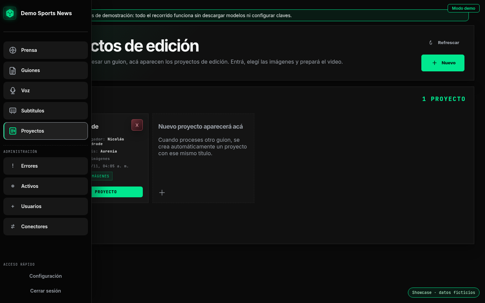

<p align="center">
  
</p>

# Video Engine

Video Engine es el motor de render final en Remotion. Su trabajo es simple y específico: recibe un snapshot ya preparado por la approval editor, lo convierte a props de Remotion y genera un MP4 final.

Este proyecto ya no es el editor. No decide imágenes, no calcula el guion, no hace preview de usuario y no es el lugar para mover audio manualmente. Todo eso vive antes, en `apps/panel`, `packages/contracts` y el servicio `services/approval-editor`.

## Official render-only flow

```txt
apps/panel
  -> services/approval-editor/lib/renderer-client.js
  -> POST /api/render on services/renderer/scripts/render/render-server.js
  -> services/renderer/scripts/render/render-video.js --profile=final
  -> services/renderer/projects/<id>/output/video-final.mp4
```

Comando oficial desde esta carpeta:

```powershell
node scripts/render-video.js --project-root=projects/<id> --profile=final
```

Resultado esperado:

```txt
projects/<id>/output/video-final.mp4
```

## Qué hace este motor

| Responsabilidad | Estado |
|---|---|
| Leer `composition-contract.json` | Sí |
| Adaptar contrato a `render-props.json` | Sí |
| Renderizar `MyComp` con Remotion | Sí |
| Escribir `output/video-final.mp4` | Sí |
| Mantener fidelidad de logo, polvo, outro, motion y timing | Sí |
| Elegir imágenes o videos | No |
| Editar filas/timings desde UI | No |
| Preview del usuario | No |
| Preparar guion/audio como negocio | No |
| Descargar imágenes o buscar assets | No, salvo compatibilidad legacy diferida |

## Archivos importantes

| Ruta | Para qué sirve |
|---|---|
| `scripts/render-video.js` | Wrapper público estable del CLI. No lo borres. |
| `scripts/render/render-video.js` | Implementación real del render final. |
| `scripts/render/render-server.js` | Frontera HTTP (`GET /health`, `POST /api/render`) que usa la approval editor. |
| `scripts/render/render-presets.js` | Presets `final`, `preview`, `demo` y `local`. |
| `scripts/lib/contracts/composition-contract.js` | Adapta el snapshot del editor a props de Remotion. |
| `src/remotion/Root.tsx` | Registro de la composición Remotion. |
| `src/remotion/Composition.tsx` | Render visual final: imágenes/videos, logo, polvo, filtros, outro y audio. |
| `assets/overlays/` | Assets locales necesarios para render final. Pesados y sensibles. |
| `tests/render-only-boundary.test.js` | Protege que no vuelva a crecer como editor/pipeline viejo. |

## Assets necesarios para render final

Antes de renderizar localmente, estos assets deben existir bajo `assets/overlays/`:

```txt
assets/overlays/
├─ particle-1.webm
├─ particle-2.webm
├─ overlay-layer-01.webm
├─ overlay-layer-02.webm
├─ outro-secondary.mp4
├─ outro-primary.mp4
├─ logo-primary.webm
├─ logo-secondary.webm
└─ logo-final.png
```

No subas assets pesados nuevos a GitHub sin decisión explícita. El repo conserva `.gitkeep` para la carpeta, pero los archivos reales pueden vivir localmente.

## Qué se limpió

Se eliminó el pipeline manual viejo y archivos generados/históricos que no forman parte del render oficial.

Ejemplos de cosas eliminadas:

- wrappers CLI manuales de `setup`, `process`, `generate timeline`, `fix timeline`, `verify sync`;
- modelo Vosk local trackeado;
- audio, imágenes y outputs generados trackeados;
- `output/video-final.mp4` histórico;
- copias duplicadas de skills dentro del subproyecto;
- API/editor local duplicado.

Lo importante: después de borrar eso, el render oficial siguió funcionando y generó MP4 correctamente.

## Deletion boundary for legacy cleanup

| Estado | Rutas |
|---|---|
| Deleted in this work unit | Pipeline manual viejo: `setup`, `process`, `generate timeline`, `fix timeline`, `verify sync`, modelo Vosk trackeado y outputs históricos. |
| Deleted in this work unit | Compatibility shims under `scripts/lib/`; callers now import the real implementation modules. |
| Deferred, still present | `scripts/transcribe-audio.py` (cliente del asr-worker), servicio local legacy y `assets/overlays/`. |

## Qué todavía NO se borra

| Ruta | Por qué se queda |
|---|---|
| `scripts/transcribe-audio.py` | Cliente de compatibilidad: el Whisper real vive en `services/asr-worker` (`ASR_WORKER_URL`); este script solo envía el audio por HTTP. |
| `scripts/approval-pipeline-local-service.js` y `scripts/services/approval-pipeline-local-service.js` | Legacy/local service diferido. No es el flujo oficial, pero no se borró en esta tanda. |
| `assets/overlays/` | Render final depende de estos assets para fidelidad visual. |

## Verificación segura

Usá estos checks. No requieren build.

```powershell
pnpm run check:render-boundary
node --test tests/approval-editor-service-v1.test.js tests/composition-contract.test.js tests/editor-contracts.test.js tests/guion-parsing.test.js tests/phrase-alignment.test.js tests/render-only-boundary.test.js
```

Prueba final real, solo cuando quieras generar MP4:

```powershell
node scripts/render-video.js --project-root="projects/<id>" --profile=final
```

## Qué NO hacer

- No correr build como validación normal.
- No revivir el editor local de este proyecto.
- No volver a usar `timeline.json` como contrato principal.
- No meter búsqueda/selección de imágenes acá.
- No borrar `assets/overlays/` sin validar render final.
- No volver a cargar faster-whisper dentro de este servicio: el modelo y el slot GPU son del asr-worker.
- `scripts/transcribe-audio.py` se mantiene como cliente HTTP del asr-worker para el caller de Control Panel.
- Do not run builds, heavy Remotion renders, model/CUDA/audio generation, or visual exports for this cleanup check.

## Estado actual probado

Se validó el flujo oficial con un proyecto de ejemplo y con la suite de render:

```bash
node --test tests/*.test.js
node scripts/render-video.js --project-root="projects/<id>" --profile=final
```

Resultado probado: MP4 final generado, con dust, logo y outro resueltos desde
`assets/overlays/` y audio/video presentes. Los tiempos reales de la pipeline
local (CPU y GPU) están en el README raíz y en `docs/INSTALL.md`.

## Scripts útiles

| Script | Uso |
|---|---|
| `pnpm run render:video` | Ejecuta el wrapper de render. Pasá args después con `--`. |
| `pnpm run check:render-boundary` | Verifica que el motor siga siendo render-only. |
| `pnpm test` | Corre tests Node. Para cambios grandes, preferí tests focalizados. |
| `pnpm run dev` | Abre Remotion Studio para inspección local. No es el flujo productivo. |
| `pnpm run lint` | ESLint + TypeScript. No correr si el usuario dijo no build/check pesado. |
| `render:server` | Inicia la frontera HTTP del renderer (`POST /api/render`). Es el flujo que usa la approval editor. |
| `approval:service:local` | Servicio local de preparación/status en `http://127.0.0.1:3041`. No es el flujo oficial de render. |
| `legacy:approval-service:local` | Alias histórico del servicio anterior. |
| `legacy:diagnose:stt` | Diagnóstico del cliente STT; reporta `ASR_WORKER_URL` y si el worker responde. |

## Servicio local de preparación

`approval:service:local` es un servicio local que solo cubre preparación/status
de proyectos para el editor: no renderiza video, y el fallback de Remotion siguen igual
que en el flujo oficial. Escucha en `http://127.0.0.1:3041` y el puerto se puede
cambiar con `APPROVAL_PIPELINE_LOCAL_SERVICE_PORT`.

```powershell
npm run approval:service:local
node -e "fetch('http://127.0.0.1:3041/health')"
```

Este servicio es de desarrollo: el flujo de producto usa la approval editor y la
frontera HTTP `render:server`.

## Relación con otros subproyectos

| Proyecto | Rol |
|---|---|
| `apps/panel` | Editor oficial, preview, selección de assets y disparador de render. |
| `services/approval-editor` | Guarda el snapshot del editor y llama al renderer por HTTP. |
| `packages/contracts` | Normalización y helpers compartidos: stable ID, parsing de guion, alignment. |
| `services/renderer` | Render final Remotion. Nada más. |

Si necesitás cambiar cómo se ve el MP4 final, tocá `src/remotion/`. Si necesitás cambiar qué se selecciona, qué fila se edita o qué polvo se elige, eso NO va acá: va en el panel o en los contratos compartidos.

## Demo render preset (CPU)

`--profile=demo` renders a 640x360 / 24 fps H.264 preview with hardware
acceleration disabled and one Remotion tab. It is the preset used by the
keyless local demo; the output is `output/video-demo.mp4`. Profiles are
resolved in `scripts/render/render-presets.js` (`final`, `preview`, `demo`).

```bash
node scripts/render-video.js --project-root=projects/<id> --profile=demo
```

## Docker

Build from the repository root (the image installs Chrome headless shell and
ffmpeg):

```bash
docker build -f services/renderer/Dockerfile -t newsroom-renderer .
docker run --rm -v "$PWD/projects:/app/projects" newsroom-renderer \
  --project-root=/app/projects/<id> --profile=demo
```
